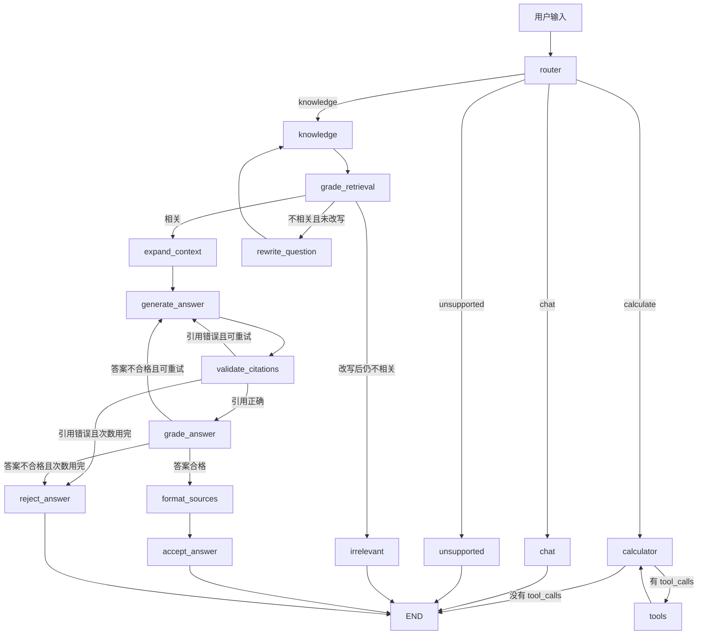

# LangChain Day7：多路线 Agentic RAG

## 1. 今天完成了什么

Day7 把前几天分散学习的能力组合成了一个完整 Agent：

- 根据问题类型选择路线；
- 使用工具执行数学计算；
- 从 Day6 知识库检索资料；
- 判断检索结果是否相关；
- 检索失败时改写问题并重试；
- 扩展命中文本块的相邻上下文；
- 根据资料生成答案；
- 检查引用编号和答案质量；
- 给答案附加可追溯来源；
- 使用 SQLite 保存对话和工作流状态；
- 临时技术故障自动重试；
- 多次重试失败后从检查点恢复；
- 查看当前状态和历史检查点。

最终代码：

```text
day07/python/day7_checkpoint_inspector.py
```

## 2. 最终 Agent 总流程



## 3. 四条主路线

| 路线 | 适用问题 | 主要处理方式 |
|---|---|---|
| `knowledge` | LangChain、LangGraph、RAG、Python、C语言课程问题 | 检索知识库并生成有依据的答案 |
| `calculate` | 数学表达式和数学运算 | 模型调用 `add`、`multiply` 工具 |
| `chat` | 问候、闲聊、依赖历史的追问 | 模型读取对话历史后直接回答 |
| `unsupported` | 当前助手不应处理的问题 | 安全拒绝 |

路由器读取完整 `messages`，因此“刚才的结果是多少”这类追问能够结合历史进入 `chat`，而不会被误判为无关问题。

## 4. AgentState 中的重要数据

| 字段 | 类型 | 作用 |
|---|---|---|
| `messages` | `list[BaseMessage]` | 完整对话及工具消息历史 |
| `original_question` | `str` | 用户最初的问题，始终不变 |
| `question` | `str` | 当前检索问题，改写后会变化 |
| `route` | `str` | 路由器选择的主路线 |
| `reason` | `str` | 路由原因 |
| `retrieved_documents` | `list[Document]` | 检索或邻居扩展后的资料 |
| `retrieval_status` | `str` | `relevant` 或 `irrelevant` |
| `rewrite_count` | `int` | 检索问题改写次数 |
| `rewrite_history` | `list[str]` | 所有实际使用过的检索问题 |
| `generation_count` | `int` | 本轮候选答案生成次数 |
| `citation_status` | `str` | 引用编号检查结果 |
| `answer_status` | `str` | 语义答案检查结果 |
| `answer_sources` | `list[str]` | 答案真正使用的来源位置 |
| `result` | `str` | 当前候选答案或最终结果 |

## 5. 三层质量控制

### 第一层：检索质量

`grade_retrieval_node` 使用 Day6 评测得到的阈值：

```python
RELEVANCE_THRESHOLD = 0.95
```

SQLiteVec 返回的是距离，距离越小越相关：

```text
distance <= 0.95 → 保留
distance > 0.95  → 丢弃
```

如果第一轮没有合格资料，模型最多改写一次问题，再重新检索。

### 第二层：引用格式

`validate_citations_node` 用 Python 正则提取：

```text
[资料 1]
[资料 2]
```

程序确定性检查：

- 是否至少存在一个引用；
- 编号是否大于等于 1；
- 编号是否小于等于实际资料数量。

这个规则明确，所以不需要调用大模型。

### 第三层：答案语义

`grade_answer_node` 使用结构化输出判断：

```python
grounded: bool
answers_question: bool
reason: str
```

只有“受资料支持”和“回答了问题”同时为真，答案才可以通过。

## 6. 为什么候选答案不能立即写入 messages

`generate_answer_node` 只把候选答案写入 `result`，不写入 `messages`。

只有答案通过引用和语义检查后，`accept_answer_node` 才执行：

```python
return {
    "messages": [AIMessage(content=state["result"])]
}
```

这样不合格答案不会进入长期记忆，也不会污染后续对话。

## 7. 文本块邻居扩展

向量检索找到的是最相似文本块，但答案需要的解释可能位于它前后。

`expand_context_node` 使用这些 metadata 定位原文顺序：

```text
source
page
start_index
chunk_id
```

然后读取命中块的前一个、当前块和后一个，为生成模型提供更完整的上下文。

## 8. 可追溯来源

`format_sources_node` 不让模型自己编写文件名和页码，而是读取：

```python
document.metadata
```

最终答案类似：

```text
RAG 保留来源可以提高可追溯性。[资料 1]

参考来源：
- [资料 1] pdf/day6_rag_test.pdf，第 2 页
```

## 9. 两种重试不要混淆

| 重试机制 | 处理问题 | 最大次数 |
|---|---|---|
| `RetryPolicy` | 网络、超时、限流、服务端临时故障 | 3 次 |
| 图中的生成循环 | 引用错误或答案质量不合格 | 总共生成 2 次 |

技术重试不会修正答案内容；质量重试也不能解决网络断线。

## 10. SQLite 检查点与恢复

`SqliteSaver` 按 `thread_id` 保存图状态。

模型服务连续失败后，程序不会伪造答案，而是保留失败节点。服务恢复后输入：

```text
retry
```

程序执行：

```python
graph.invoke(None, config=config)
```

`None` 表示不添加新的用户输入，直接从保存的待执行节点恢复。

## 11. 检查点观察命令

```text
status
```

内部调用：

```python
graph.get_state(config)
```

用于查看最新状态和下一节点。

```text
history
```

内部调用：

```python
graph.get_state_history(config, limit=10)
```

用于查看最近十个检查点，结果从新到旧排列。

## 12. Day7 文件演进顺序

1. `day7_router_basic.py`：结构化问题路由。
2. `day7_router_calculator.py`：计算路线与工具循环。
3. `day7_router_retriever.py`：连接 Day6 向量数据库。
4. `day7_retrieval_guard.py`：检索距离守门。
5. `day7_rag_generation.py`：根据资料生成答案。
6. `day7_query_rewrite.py`：检索失败时改写问题。
7. `day7_multi_route_agent.py`：补全普通聊天路线。
8. `day7_persistent_agent.py`：SQLite 会话记忆。
9. `day7_filtered_context_agent.py`：逐份过滤无关资料。
10. `day7_neighbor_context_agent.py`：补充相邻文本块。
11. `day7_answer_grader.py`：生成答案质量检查。
12. `day7_citation_validator.py`：确定性引用校验。
13. `day7_source_formatter.py`：生成真实来源清单。
14. `day7_resilient_agent.py`：节点级技术故障重试。
15. `day7_recoverable_agent.py`：失败后从检查点恢复。
16. `day7_checkpoint_inspector.py`：观察状态与历史。

## 13. 综合测试清单

启动：

```bash
python day07/python/day7_checkpoint_inspector.py xiaolin-day7-final-001
```

依次测试：

### 测试 1：计算工具路线

```text
我叫小林，请计算 (20+4)*3。
```

预期：路线是 `calculate`，依次调用 `add`、`multiply`，结果为 72。

### 测试 2：历史记忆

```text
我叫什么？刚才的计算结果是多少？
```

预期：路线是 `chat`，回答“小林”和“72”。

### 测试 3：知识库路线

```text
为什么 RAG 要保留来源信息？
```

预期：完成检索、过滤、邻居扩展、生成、引用检查和答案检查，并给出真实来源。

### 测试 4：知识库之外的问题

```text
今天北京天气怎么样？
```

预期：知识检索无法通过阈值；改写一次仍不相关后安全拒绝。

### 测试 5：查看当前状态

```text
status
```

预期：只读取检查点，不增加消息数量。

### 测试 6：查看检查点历史

```text
history
```

预期：显示最近十个检查点，从最新到最早排列。

### 测试 7：跨进程持久化

输入 `exit`，重新运行相同的 `thread_id`，然后提问：

```text
我叫什么？
```

预期：仍然记得“小林”。

## 14. 今天最重要的结论

普通 RAG 是一条固定链：

```text
问题 → 检索 → 生成
```

Agentic RAG 会根据中间结果动态决策：

```text
问题
→ 选择路线
→ 检索并评估
→ 必要时改写重试
→ 生成并检查
→ 必要时重新生成
→ 保存可信答案
```

Day7 的核心不是“多调用几次模型”，而是让每个节点职责单一、状态明确、失败可判断、结果可追溯、流程可恢复。

## 15. Day8 预告

Day8 将从“固定图中的动态分支”继续前进到“任务规划”：

- 把复杂任务拆成多个子任务；
- 保存待办步骤和完成状态；
- 按计划逐步调用工具；
- 根据中间结果修改后续计划；
- 汇总多个步骤形成最终答案。
