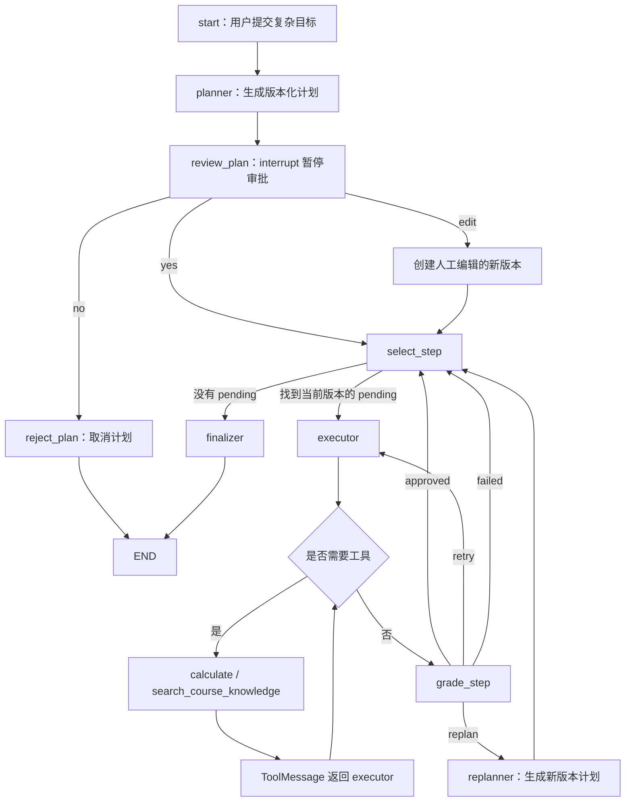

# LangChain Day8：任务规划、执行、检查与动态重规划

## 1. 今天完成了什么

Day8 从“一次回答一个问题”前进到了“围绕复杂目标持续工作”：

- 把复杂目标拆成结构化步骤；
- 把计划放入 LangGraph 状态；
- 自动选择下一条待办步骤；
- 逐步执行并传递前序结果；
- 检查每一步的执行质量；
- 不合格时根据反馈重新执行；
- 连续失败时动态修改剩余计划；
- 分离步骤唯一ID、计划版本和执行顺序；
- 在执行前暂停并等待人工审批；
- 支持跨进程批准、拒绝和编辑计划；
- 允许执行器调用真实计算和知识库工具；
- 汇总全部步骤形成最终交付结果。

最终代码：

```text
day08/python/day8_tool_planning_agent.py
```

## 2. 最终工作流



## 3. 结构化计划

规划模型返回两层 Pydantic 对象：

```python
class PlanStep(BaseModel):
    description: str
    expected_output: str
    status: Literal["pending", "completed"]


class TaskPlan(BaseModel):
    goal: str
    steps: list[PlanStep]
```

调用：

```python
planner_llm = llm.with_structured_output(
    TaskPlan,
    method="function_calling"
)
```

模型负责理解和拆解任务，Python 负责身份编号、状态管理和执行顺序。

## 4. PlanState

最终状态中的主要字段：

| 字段 | 类型 | 作用 |
|---|---|---|
| `user_goal` | `str` | 用户原始目标 |
| `plan_goal` | `str` | 规划器整理后的目标 |
| `steps` | `list[dict]` | 所有版本的步骤和执行结果 |
| `current_step` | `dict \| None` | 当前正在处理的步骤 |
| `current_result` | `str` | 最近一次执行结果 |
| `step_decision` | `str` | `approved/retry/replan/failed` |
| `step_grade_reason` | `str` | 步骤质量检查原因 |
| `step_improvement` | `str` | 再次执行时的改进建议 |
| `replan_count` | `int` | 动态重规划次数 |
| `current_plan_version` | `int` | 当前生效计划版本 |
| `next_step_number` | `int` | 下一个唯一ID数字 |
| `plan_approved` | `bool` | 人工是否批准计划 |
| `final_answer` | `str` | 最终汇总结果 |

## 5. 步骤身份、版本与顺序

这三个概念不能混在一起：

```python
{
    "step_id": "step-005",
    "plan_version": 2,
    "order": 1
}
```

| 字段 | 含义 |
|---|---|
| `step_id` | 永久唯一身份，用于日志和状态更新 |
| `plan_version` | 属于哪一版计划 |
| `order` | 在该版本内的执行顺序 |

选择器只选择当前版本：

```python
step["plan_version"] == state["current_plan_version"]
and step["status"] == "pending"
```

然后按 `order` 选择最小值，而不是依赖列表位置或 `step_id`。

## 6. 步骤状态变化

正常执行：

```text
pending → in_progress → completed
```

第一次不合格：

```text
pending → in_progress → pending → 再执行
```

连续两次不合格：

```text
in_progress → failed
```

计划被人工编辑或动态重规划替代：

```text
pending → cancelled
```

## 7. 质量检查和重试

检查器返回：

```python
class StepEvaluation(BaseModel):
    passed: bool
    reason: str
    improvement: str
```

每条步骤最多执行：

```python
MAX_STEP_ATTEMPTS = 2
```

整个任务最多动态重规划：

```python
MAX_REPLAN_ATTEMPTS = 1
```

这两个上限防止图无限循环。

## 8. 动态重规划

某一步连续失败后：

1. 当前失败步骤保留为 `failed`；
2. 旧版本剩余 `pending` 步骤变为 `cancelled`；
3. 重规划器读取已完成结果、失败原因和改进建议；
4. 生成1到4条替代步骤；
5. `current_plan_version` 加1；
6. 新步骤的 `order` 从1开始；
7. `step_id` 继续使用全局唯一编号。

模型只提出新任务内容，所有身份和版本字段都由 Python 分配。

## 9. 人工审批

规划完成后执行：

```python
decision = interrupt({...})
```

支持三种决定：

| 决定 | 结果 |
|---|---|
| `yes` | 执行原计划 |
| `no` | 取消计划，不执行 |
| `edit` | 创建人工编辑的新版本并执行 |

恢复时：

```python
graph.invoke(
    Command(resume=decision),
    config=config
)
```

SQLite Checkpointer 让开始和恢复可以发生在不同进程中。

## 10. 真实工具调用

### calculate

```python
calculate(a, b, operation)
```

支持 `add` 和 `multiply`，数学结果由 Python 计算。

### search_course_knowledge

读取：

```text
day06/database/day6_knowledge_cli.db
```

当前版本使用 SQL `LIKE` 关键词查询，返回正文和来源 metadata。

### 工具调用循环

```text
executor_llm
→ tool_calls
→ Python执行工具
→ ToolMessage
→ executor_llm
→ 最终步骤结果
```

每个步骤最多进行5轮工具调用。工具名称、参数和结果会附加到步骤结果，供质量检查和最终汇总使用。

## 11. 跨进程命令

创建任务：

```bash
python day08/python/day8_tool_planning_agent.py start task-001
```

批准：

```bash
python day08/python/day8_tool_planning_agent.py resume task-001 yes
```

拒绝：

```bash
python day08/python/day8_tool_planning_agent.py resume task-001 no
```

编辑并批准：

```bash
python day08/python/day8_tool_planning_agent.py resume task-001 edit
```

## 12. 综合测试

推荐目标：

```text
从本地课程知识库查找RAG的定义，计算(20+4)*3，然后整理成一张学习卡片。
```

应该观察到：

1. `planner` 生成版本1计划；
2. `review_plan` 暂停；
3. 程序退出后状态仍在数据库；
4. `resume ... yes` 恢复；
5. 知识步骤调用 `search_course_knowledge`；
6. 计算步骤调用一次加法和一次乘法；
7. 每个结果经过 `grade_step`；
8. 所有步骤处理后进入 `finalizer`；
9. 最终答案包含知识资料、计算结果和学习卡片。

测试 `no` 和 `edit` 时请使用不同的 `thread_id`。

## 13. 文件演进顺序

1. `day8_plan_basic.py`：结构化计划。
2. `day8_plan_graph.py`：计划进入 LangGraph 状态。
3. `day8_plan_executor.py`：执行第一条步骤。
4. `day8_plan_loop.py`：循环执行全部步骤。
5. `day8_plan_finalizer.py`：汇总最终结果。
6. `day8_step_grader.py`：检查和重做步骤。
7. `day8_dynamic_replanner.py`：失败后修改计划。
8. `day8_versioned_replanner.py`：分离ID、版本和顺序。
9. `day8_plan_approval.py`：同进程人工审批。
10. `day8_plan_approval_persistent.py`：跨进程审批。
11. `day8_plan_edit_approval.py`：人工编辑计划。
12. `day8_tool_planning_agent.py`：执行器调用真实工具。

## 14. 今天最重要的结论

计划型 Agent 不是让模型一次输出很长的答案，而是把复杂工作变成受控状态机：

```text
规划
→ 人工检查
→ 选择一步
→ 执行
→ 验证
→ 必要时重做或重规划
→ 汇总
```

模型适合负责语义任务：规划、执行文本任务、质量判断和重规划。

Python 和 LangGraph 负责确定性控制：唯一ID、版本、顺序、次数上限、条件边、工具执行、暂停恢复和数据库持久化。

可靠 Agent 的关键不是“让模型更自由”，而是让模型的每一次决定都处在明确的状态、边界和检查机制中。

## 15. Day9 预告

Day9 可以继续学习多 Agent 协作：

- 一个主管 Agent 分派任务；
- 多个专业 Agent 分别研究、计算或编写内容；
- 专业 Agent 之间传递结构化结果；
- 主管检查结果并决定是否返工；
- 汇总多个 Agent 的输出形成最终交付。
