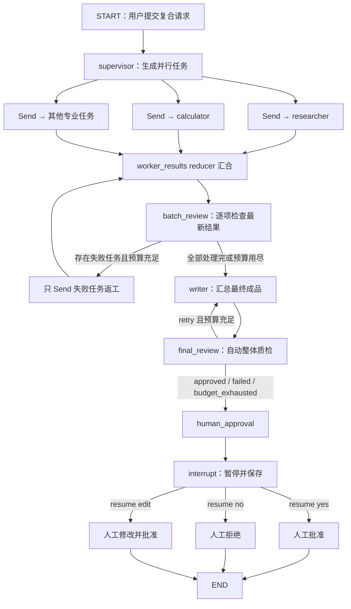

# LangChain Day9：主管 Agent、并行专业 Agent 与人工验收

## 1. 今天完成了什么

Day9 把前几天学过的工具、状态、分支、持久化和人工审批组合成了一个多 Agent 团队：

- 主管理解复合请求并分配专业任务；
- researcher 和 calculator 各自使用专属工具；
- 使用 `Send` 动态创建并行工作单元；
- 使用 reducer 合并并行节点返回的数据；
- 自动检查每项专业结果，只返工失败任务；
- writer 汇总所有专业结果；
- 最终检查器检查完整成品，必要时让 writer 重写；
- SQLite 保存工作流状态和节点审计记录；
- 统计模型调用、工具调用和 Token 用量；
- 达到预算后停止可选返工；
- 最终结果交给人批准、拒绝或修改后批准。

最终代码：

```text
day09/python/day9_human_acceptance.py
```

## 2. Day9 的渐进练习

| 顺序 | 文件 | 新增重点 |
|---|---|---|
| 1 | `day9_supervisor_basic.py` | 主管输出结构化委派决定 |
| 2 | `day9_supervisor_graph.py` | 主管与专业节点组成 LangGraph |
| 3 | `day9_supervisor_review.py` | 主管检查专业结果并控制重试 |
| 4 | `day9_multi_agent_team.py` | 一次请求拆成多个团队任务 |
| 5 | `day9_specialist_tools.py` | 不同专业 Agent 拥有不同工具 |
| 6 | `day9_parallel_team.py` | `Send` 动态并行和 reducer 汇合 |
| 7 | `day9_parallel_review.py` | 只并行返工未通过的任务 |
| 8 | `day9_parallel_persistent.py` | SQLite 跨进程持久化 |
| 9 | `day9_parallel_observable.py` | 流式节点事件与审计日志 |
| 10 | `day9_final_review.py` | writer 成品的自动最终质检 |
| 11 | `day9_budget_control.py` | 模型、工具和 Token 预算 |
| 12 | `day9_human_acceptance.py` | 最终人工验收与恢复执行 |

## 3. 最终工作流



## 4. 模型对象与逻辑角色

程序只创建了一个基础聊天模型配置：

```python
llm = ChatOpenAI(...)
```

然后从它派生出不同能力的 Runnable：

| 对象 | 逻辑角色 | 特殊能力 |
|---|---|---|
| `llm` | writer | 普通文本生成 |
| `researcher_llm` | 研究员 | 绑定知识库搜索工具 |
| `calculator_llm` | 计算员 | 绑定计算工具 |
| `supervisor_llm` | 主管规划器 | 输出 `ParallelPlan` |
| `reviewer_llm` | 专业结果检查器 | 输出 `WorkerReview` |
| `final_reviewer_llm` | 最终成品检查器 | 输出 `FinalReview` |

它们不是六个分别下载或常驻内存的模型，而是同一个模型服务的六种调用配置。一次完整任务会发生多次 API 调用。

## 5. 结构化数据模型

### ParallelAssignment

描述一项可以独立执行的专业任务：

```python
worker: Literal["researcher", "calculator"]
task: str
expected_output: str
```

### ParallelPlan

主管返回团队目标以及 1 到 4 项并行任务：

```python
goal: str
assignments: list[ParallelAssignment]
```

### WorkerReview

检查单项专业结果：

```python
approved: bool
reason: str
feedback: str
```

### FinalReview

检查 writer 汇总后的完整成品，字段与单项检查类似，但检查范围是最终回答。

## 6. ParallelTeamState

| 字段 | 类型 | 数据生产者 | 用途 |
|---|---|---|---|
| `user_request` | `str` | 命令行 | 用户原始复合请求 |
| `team_goal` | `str` | supervisor | 团队统一目标 |
| `assignments` | `list[dict]` | supervisor | 初始并行任务 |
| `worker_results` | reducer 列表 | specialist_worker | 保存所有执行次数的专业结果 |
| `result_reviews` | `dict` | batch_review | 每项任务的最新检查结论 |
| `retry_assignments` | `list[dict]` | batch_review | 需要返工的任务 |
| `final_answer` | `str` | writer / 人工编辑 | 最终成品 |
| `writer_attempts` | `int` | writer | writer 已执行次数 |
| `final_review_status` | `str` | final_review | 自动成品质检状态 |
| `final_review_reason` | `str` | final_review | 自动质检原因 |
| `final_review_feedback` | `str` | final_review | writer 重写意见 |
| `human_approval_status` | `str` | human_approval | 人工最终决定 |
| `human_approval_note` | `str` | human_approval | 人工验收说明 |
| `model_calls` | reducer 整数 | 所有模型节点 | 累计模型调用次数 |
| `tool_calls` | reducer 整数 | specialist_worker | 累计工具调用次数 |
| `total_tokens` | reducer 整数 | 所有模型节点 | 累计 Token 总量 |

## 7. 为什么并行字段需要 reducer

多个 `specialist_worker` 可能同时返回：

```python
{"worker_results": [research_result]}
{"worker_results": [calculate_result]}
```

如果状态字段没有合并规则，并行写入同一字段会发生冲突。定义：

```python
worker_results: Annotated[list[dict], operator.add]
```

LangGraph 会把列表相加：

```text
[research_result] + [calculate_result]
                    ↓
[research_result, calculate_result]
```

资源计数同样使用 `operator.add`。节点必须返回本节点新增的数量，而不是累计总量，否则会重复相加。

## 8. supervisor 和 Send

`supervisor_node()` 调用结构化模型，把任务补上由 Python 生成的稳定编号：

```text
parallel-001
parallel-002
...
```

`dispatch_workers()` 不直接执行专业节点，而是返回多个 `Send`：

```python
Send("specialist_worker", {"assignment": assignment})
```

每个 `Send` 都是一次独立节点调用。任务互不依赖时才能并行；存在先后依赖的任务不应被主管拆成同一批并行任务。

## 9. 专业工具隔离

researcher 只能访问：

```text
search_course_knowledge
```

calculator 只能访问：

```text
calculate
```

这体现最小权限原则。即使模型提出不存在或无权使用的工具，Python 也会通过对应 `tool_map` 拒绝执行。

工具调用循环的数据流：

```text
消息 → 专业模型
       ├─ 无 tool_calls → 得到专业结果
       └─ 有 tool_calls
              ↓
          Python 执行工具
              ↓
          ToolMessage 加回消息
              ↓
          再次调用专业模型
```

工具循环最多五轮，避免模型无限调用工具。

## 10. batch_review 与定向返工

`worker_results` 会保留第一次和返工结果。`get_latest_results()` 按：

```python
assignment_id + 最大 attempt
```

选出每项任务的最新结果。

检查结论包括：

- `approved`：结果合格；
- `retry`：未合格且还有执行机会；
- `failed`：达到专业任务次数上限。

返工时只为 `retry_assignments` 创建新的 `Send`，已经通过的任务不会重复执行，也不会重复调用检查模型。

## 11. writer 与最终自动质检

writer 按 `assignment_id` 排序结果，避免并行完成顺序改变最终展示顺序。

`final_review_node()` 检查：

- 是否回答了原始请求；
- 是否忠实使用专业结果；
- 是否保留必要来源和计算结论；
- 是否存在需要重写的问题。

writer 最多执行两次：

```python
MAX_WRITER_ATTEMPTS = 2
```

最终状态可能是：

| 状态 | 含义 |
|---|---|
| `approved` | 自动质检通过 |
| `retry` | 返回 writer 重写 |
| `failed` | 重写次数已经用完 |
| `budget_exhausted` | 资源预算不允许继续重写 |

## 12. 资源预算

默认上限：

```python
MAX_MODEL_CALLS = 30
MAX_TOOL_CALLS = 20
MAX_TOTAL_TOKENS = 50_000
```

模型节点通过 `UsageMetadataCallbackHandler` 读取 Token 使用量。每个节点返回本次增量，reducer 将其累加到全局状态。

达到任何一个上限后：

- 已经取得的结果不会丢失；
- 不再发起可选的专业返工；
- 不再进行可选的 writer 重写；
- 现有成品仍进入人工验收。

并行任务会分别执行，然后在汇合点累计用量。因此这是一种“同步点预算守门”，不是在并行调用执行到一半时强行终止网络请求。

## 13. 最终人工验收

`human_approval_node()` 调用：

```python
decision = interrupt({...})
```

第一次进入节点时，`interrupt()` 保存状态并暂停。恢复时：

```python
Command(resume=resume_value)
```

传入的数据会成为 `interrupt()` 的返回值，节点从头重新进入，然后在同一个 `interrupt()` 位置取得人工决定。

| 决定 | 状态 | 最终回答变化 |
|---|---|---|
| `yes` | `approved` | 不变 |
| `no` | `rejected` | 不变，但不获批准 |
| `edit` | `edited_and_approved` | 替换为人工输入内容 |

自动检查器只提供质量建议；人工拥有最终交付权。

## 14. 持久化和审计

最终数据库：

```text
day09/database/day9_human_acceptance.db
```

数据库同时保存：

1. LangGraph SQLite Checkpointer 的状态快照；
2. 自定义 `team_audit_logs` 节点事件日志。

`thread_id` 是一次工作流的唯一编号。因为 reducer 状态会累加，开始新任务时必须使用新的 `thread_id`。

## 15. 运行命令

开始：

```bash
python day09/python/day9_human_acceptance.py start human-001
```

查看状态：

```bash
python day09/python/day9_human_acceptance.py status human-001
```

查看审计日志：

```bash
python day09/python/day9_human_acceptance.py logs human-001
```

批准：

```bash
python day09/python/day9_human_acceptance.py resume human-001 yes
```

拒绝：

```bash
python day09/python/day9_human_acceptance.py resume human-001 no
```

修改后批准：

```bash
python day09/python/day9_human_acceptance.py resume human-001 edit
```

## 16. 最终完整数据流

```text
用户复合请求 str
    ↓
supervisor_llm → ParallelPlan
    ↓
Python 添加 assignment_id
    ↓
dispatch_workers → list[Send]
    ↓
多个 specialist_worker 并行运行
    ↓                         ↓
工具调用与 ToolMessage       模型/工具/Token 增量
    ↓                         ↓
worker_results reducer + 资源计数 reducer
    ↓
batch_review 检查每项最新结果
    ├─ retry → 只返工失败任务
    └─ 完成或预算到限
             ↓
writer 汇总 final_answer
             ↓
final_review 自动整体质检
    ├─ retry → writer
    └─ 不再重写
             ↓
human_approval → interrupt
             ↓
SQLite 保存暂停状态
    ├─ Command(resume=yes)
    ├─ Command(resume=no)
    └─ Command(resume=edit)
             ↓
            END
```

## 17. 常见易错点

1. 并行节点写同一字段却没有 reducer，会产生并发更新错误。
2. reducer 数字字段应返回增量，不能返回已经累计的总量。
3. `Send` 的输入必须符合目标节点需要的状态结构。
4. 不能假设并行任务的完成顺序固定。
5. 返工结果不能简单覆盖历史，应通过 `attempt` 找最新结果。
6. 工具权限应由 Python 的工具映射控制，不能只依赖提示词。
7. `interrupt()` 必须配合 checkpointer 和稳定的 `thread_id`。
8. 恢复暂停流程要使用 `Command(resume=...)`，不是重新 `start`。
9. 新任务不能复用旧 `thread_id`，否则 reducer 数据可能继续累加。
10. 自动质检失败不代表程序崩溃，它仍可交给人工做最终判断。

## 18. Day9 的核心结论

多 Agent 并不只是“多调用几个模型”。真正重要的是明确：

- 谁负责任务分解；
- 谁能访问哪些工具；
- 哪些任务可以并行；
- 并行结果如何安全汇合；
- 谁负责检查和返工；
- 如何限制成本和循环；
- 状态如何跨进程保存；
- 最终决定权属于模型还是人。

Day9 的最终程序已经形成一个小型但完整的多 Agent 工作系统：主管规划、专业执行、并行汇合、分层质检、预算守门、持久化、审计以及人工最终验收。
