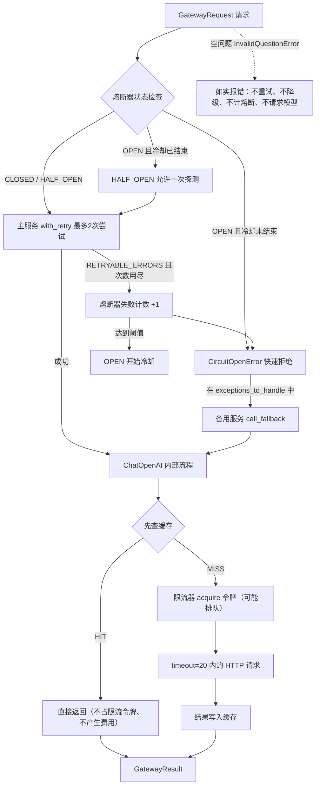

# LangChain Day10：生产级可靠性、重试、降级与可观测性

## 1. 今天完成了什么

Day10 关注的问题不再是"功能能不能实现"，而是"服务在真实条件下还能不能稳定运行"。今天给模型调用逐层加装了七个生产组件：

- 超时：限制单次 HTTP 请求最长等待时间；
- 重试：区分可重试错误与不可重试错误，限定总尝试次数；
- 降级：主服务彻底失败后自动切换备用服务；
- 熔断：下游明显故障时本地快速拒绝，不再继续请求；
- 限流：控制请求进入速度，保护模型服务商和自己；
- 缓存：相同请求直接读取 SQLite，不再消耗 Token；
- 可观测性：用回调处理器记录调用树、延迟、Token 和错误，并落盘保存。

最终整合程序把七者组合成一个模型网关，七个场景一次演示全部行为。

最终代码：

```text
day10/python/day10_reliable_gateway.py
```

## 2. Day10 的渐进练习

| 顺序 | 文件 | 新增重点 |
|---|---|---|
| 1 | `day10_retry_basic.py` | `with_retry()` 基础：可重试错误 vs 不可重试错误 |
| 2 | `day10_model_retry.py` | 真实模型的 `timeout` 和两层重试配置 |
| 3 | `day10_model_fallback.py` | `with_fallbacks()` 降级与 `exception_key` |
| 4 | `day10_circuit_breaker.py` | 熔断器三状态转换（模拟时钟） |
| 5 | `day10_rate_limiter.py` | `InMemoryRateLimiter` 阻塞与非阻塞模式 |
| 6 | `day10_model_cache.py` | `BaseCache` 接口与 SQLite 持久化缓存 |
| 7 | `day10_observability.py` | 回调处理器追踪调用树并写入 SQLite |
| 8 | `day10_reliable_gateway.py` | 最终整合：全组件生产级模型网关 |

## 3. 最终工作流



## 4. 六个可靠性组件的分工

| 组件 | 回答的问题 | 失效场景 |
|---|---|---|
| 超时 | 一次最多等多久 | 对方长时间不响应 |
| 重试 | 失败后再试几次 | 短暂抖动、瞬时过载 |
| 降级 | 主服务不行了用谁 | 主服务持续故障 |
| 熔断 | 还要不要继续请求 | 下游已经明显故障 |
| 限流 | 请求以多快速度进入 | 流量超过承受能力 |
| 缓存 | 重复请求要不要再算 | 相同输入反复出现 |

组合口诀：**限流管进入，缓存管重复，超时管单次，重试管抖动，熔断管故障，降级管兜底。**

## 5. 两层重试配置

```python
llm = ChatOpenAI(..., timeout=20, max_retries=0)

reliable = basic_runnable.with_retry(
    retry_if_exception_type=(...),
    wait_exponential_jitter=False,
    stop_after_attempt=3
)
```

- `ChatOpenAI(max_retries=0)`：关闭模型客户端自己的重试，保证整个系统只有一层重试逻辑。如果两层都开，实际尝试次数会相乘（3 × 3 = 9 次）。
- `stop_after_attempt=3` 是**总共**最多执行三次，不是"失败后再额外重试三次"。
- `wait_exponential_jitter=False` 是为了练习立即完成；生产环境应启用指数退避加抖动，避免雪崩式同时重试。

## 6. 降级的包装顺序

```text
原始主服务
    ↓ with_retry            （处理抖动）
具备重试能力的主服务
    ↓ CircuitBreaker        （统计请求级失败）
受熔断保护的主链路
    ↓ with_fallbacks        （彻底失败后兜底）
完整容错服务
```

- `exception_key="last_error"` 会把主链路最后的异常注入备用服务的输入字典，备用服务因此知道**为什么**被启用，可以记录降级原因。
- `CircuitOpenError` 也必须放进 `exceptions_to_handle`，熔断打开时的请求才能降级而不是直接失败。
- `InvalidQuestionError` 不放进任何捕获范围：无效输入重试无意义、降级也无意义，必须如实、立即失败。

## 7. 熔断器三状态

```text
CLOSED（正常放行）
    ↓ 连续失败达到 failure_threshold
OPEN（本地快速拒绝，不请求下游）
    ↓ 冷却 recovery_timeout 到期后的下一次请求
HALF_OPEN（只放行一次探测）
    ├── 探测成功 → CLOSED，失败计数清零
    └── 探测失败 → 重新 OPEN
```

关键验证：OPEN 期间发起请求，主服务尝试次数**不增加**——请求在本地就被拒绝了，避免大量超时等待、无效重试和费用浪费。HALF_OPEN 探测如果命中缓存，甚至可以零 Token 恢复。

## 8. 缓存的键和边界

缓存键 = `SHA-256(问题 + llm_string)`，其中 `llm_string` 是完整模型调用配置。因此以下变化都会产生新键、无法命中旧缓存：

- 更换模型；
- 修改温度或其他参数；
- 修改提示词中的任意一个字符（包括标点）。

内部顺序（`ChatOpenAI._generate_with_cache` 源码确认）：

```text
缓存 lookup
  ├─ HIT → 直接返回：不占限流令牌、不产生费用
  └─ MISS → 限流器 acquire → 真实 HTTP 请求 → update 写入缓存
```

缓存适合可复用的静态请求（解释概念、总结文档）。天气、余额、库存等实时数据不应长时间使用旧缓存，需要设置过期时间或不缓存。

## 9. 可观测性：回调处理器

把自定义 `BaseCallbackHandler` 挂在最外层 Runnable 的 `config={"callbacks": [...]}` 上，内部所有环节的事件都会向上冒泡：

| 事件 | 触发时机 | 记录内容 |
|---|---|---|
| `on_chain_start` | 每个 Runnable 开始（含重试包装器） | 运行名、输入、标签 |
| `on_chain_error` | 任一环节抛错 | 错误类型和内容 |
| `on_chat_model_start` | 即将调用模型 | 消息结构 |
| `on_llm_end` | 模型返回 | 延迟、Token 用量 |
| `on_llm_error` | 模型调用失败 | 错误信息 |

事件的 `run_id` 和 `parent_run_id` 组成调用树，可以还原哪个环节慢、哪里失败、重试了几次。所有事件写入 `day10/database/day10_trace.db`，程序结束后仍可回查。

生产替代方案：`langsmith` 已随 langchain 安装，设置 `LANGSMITH_TRACING=true` 和 `LANGSMITH_API_KEY` 后同样的调用会自动上报，在网页查看完整调用树，不需要自己维护回调。

## 10. 关键参数速查

| 参数 | 所属组件 | 含义 |
|---|---|---|
| `timeout` | ChatOpenAI | 单次请求最长等待秒数 |
| `max_retries` | ChatOpenAI | 客户端内置重试次数（本课程设 0） |
| `retry_if_exception_type` | `with_retry` | 哪些异常才重试 |
| `stop_after_attempt` | `with_retry` | 总尝试次数上限 |
| `wait_exponential_jitter` | `with_retry` | 是否指数退避加抖动 |
| `exceptions_to_handle` | `with_fallbacks` | 哪些异常触发降级 |
| `exception_key` | `with_fallbacks` | 异常注入输入的字段名 |
| `failure_threshold` | CircuitBreaker | 连续失败几次打开 |
| `recovery_timeout` | CircuitBreaker | OPEN 冷却时长 |
| `requests_per_second` | InMemoryRateLimiter | 令牌产生速度 |
| `max_bucket_size` | InMemoryRateLimiter | 允许积累的突发量 |
| `cache` | ChatOpenAI | 缓存对象 |
| `rate_limiter` | ChatOpenAI | 限流器对象 |

## 11. 运行方式

```bash
cd /path/to/learning-agent
source .venv/bin/activate

# 逐步练习
python day10/python/day10_retry_basic.py
python day10/python/day10_model_retry.py
python day10/python/day10_model_fallback.py
python day10/python/day10_circuit_breaker.py
python day10/python/day10_rate_limiter.py
python day10/python/day10_model_cache.py
python day10/python/day10_observability.py

# 最终整合网关
python day10/python/day10_reliable_gateway.py
```

第一次运行网关消耗约 4 次真实模型调用；再次运行时全部命中缓存，真实 API 次数为 0。

## 12. 常见易错点

1. `stop_after_attempt=3` 是总次数，包含第一次调用。
2. 两层重试（客户端 + with_retry）同时开会相乘，应关掉一层。
3. 教学用 `wait_exponential_jitter=False`，生产要开启退避。
4. 缓存键包含模型配置，改一个标点就 MISS。
5. 缓存命中不占限流令牌（先查缓存后限流），也不产生费用。
6. 缓存命中仍会触发 `on_chat_model_start` / `on_llm_end`；延迟接近零是识别特征，统计真实 Token 时要扣除缓存回放的旧 usage。
7. 熔断器要包在重试外层：统计"整个请求失败"而不是"每次尝试失败"。
8. `CircuitOpenError` 要加入 `exceptions_to_handle`，熔断期间的请求才能降级。
9. 无效输入错误不要放进可重试/可降级范围，让它如实、立即失败。
10. 当前 langchain-core 版本中 `RunnableRetry` 不触发 `on_retry` 回调，重试子运行用 `retry:attempt:N` 标签标记，从 `on_chain_start` 的 tags 识别。
11. 当前版本的 `run_id` 是 UUIDv7（前缀是毫秒时间戳），展示区分度要用尾部字符。
12. `on_chain_start` 的 `serialized` 参数可能为 `None`，取名字前要先判空。
13. 实时性数据（天气、库存、余额）不要长时间使用缓存。
14. 主备服务共用限流器和缓存是合理的：限流保护的是服务商，缓存键里的模型配置会自动区分不同模型。

## 13. Day10 的核心结论

可靠的不是某一个组件，而是分层明确的责任边界：

- 每种故障模式对应一个组件，不重复设防也不留空白；
- 包装顺序有讲究：重试在最内层处理抖动，熔断在中间统计故障，降级在最外层兜底；
- 永远区分"临时错误"和"永久错误"：前者值得重试，后者必须立即如实失败；
- 所有保护都要可观测：没有追踪数据，就无法知道重试是否发生、降级是否频繁、缓存是否有效、费用花在哪里。

Day10 之后，这个学习项目已经覆盖了从基础调用到多 Agent 协作再到生产级运维的完整链路。
