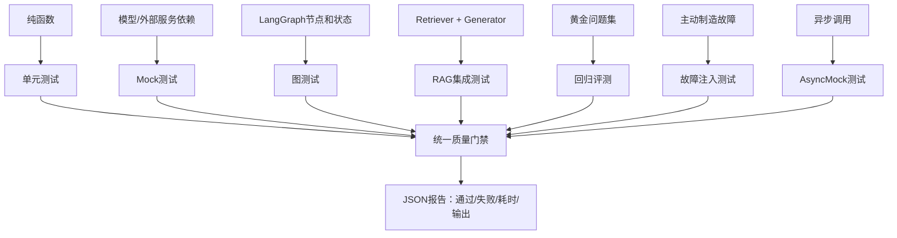

# LangChain Day11：测试、评估、回归保护与质量工程

## 1. 今天完成了什么

Day10 解决了“系统如何稳定运行”，Day11 解决的是“如何证明系统运行正确”。

今天建立了七层质量保护：

- 单元测试：验证纯函数和边界规则；
- Mock 测试：验证模型调用次数、参数和降级路径；
- LangGraph 测试：验证节点顺序、状态和条件路由；
- RAG 集成测试：验证检索、上下文组装和回答之间的数据流；
- 回归评测：用黄金问题集检查来源准确率和拒答行为；
- 故障注入：主动制造故障，检查重试和降级是否符合设计；
- 异步测试：验证 `ainvoke`、异步重试和异步降级；
- 统一质量门禁：一次运行全部检查并保存 JSON 报告。

## 2. 今天的代码

| 顺序 | 文件 | 重点 |
|---|---|---|
| 1 | `day11_unit_test_basic.py` | `unittest` 测试纯函数和熔断计数 |
| 2 | `day11_mock_test.py` | `Mock` 测试模型调用路径 |
| 3 | `day11_graph_test.py` | 测试 LangGraph 节点与条件边 |
| 4 | `day11_regression_eval.py` | 黄金数据集和来源/拒答评测 |
| 5 | `day11_rag_integration_test.py` | 测试 RAG 完整数据流 |
| 6 | `day11_quality_gate.py` | 统一运行全部质量检查 |
| 7 | `day11_failure_injection.py` | 主动注入故障测试重试和降级 |
| 8 | `day11_async_test.py` | `AsyncMock` 和异步工作流测试 |

## 3. 测试层次



测试范围越大，越接近真实用户场景，但执行速度和依赖数量也会增加。

## 4. 单元测试

文件：

```text
day11/python/day11_unit_test_basic.py
```

测试对象是没有网络依赖的纯逻辑：

```python
is_retryable_error(error_name)
make_cache_key(prompt, model_config)
should_open_circuit(failure_count, failure_threshold)
```

典型断言：

```python
self.assertTrue(...)
self.assertFalse(...)
self.assertEqual(actual, expected)
self.assertNotEqual(first, second)
```

异常断言：

```python
with self.assertRaises(ValueError):
    should_open_circuit(-1, 2)
```

本项目特别测试了熔断计数成功后复位：

```text
失败 → 成功 → 失败
```

第二次失败必须重新从1开始，而不能错误地延续前一次失败。

运行：

```bash
python day11/python/day11_unit_test_basic.py
```

## 5. Mock 测试

文件：

```text
day11/python/day11_mock_test.py
```

真实模型不适合直接用于每次测试，因为它会：

- 消耗 API Token；
- 受网络影响；
- 返回结果不完全稳定；
- 运行速度慢。

使用：

```python
from unittest.mock import Mock
```

固定返回值：

```python
primary = Mock(return_value="主模型回答")
```

按调用顺序制造行为：

```python
primary = Mock(side_effect=[
    TemporaryModelError("第一次失败"),
    "第二次成功"
])
```

验证调用情况：

```python
primary.assert_called_once_with("问题")
fallback.assert_not_called()
```

Mock 测试检查的不只是最终回答，还检查：

- 调用了哪个服务；
- 调用了几次；
- 参数是否正确；
- 是否错误调用了备用服务。

## 6. LangGraph 测试

文件：

```text
day11/python/day11_graph_test.py
```

测试图结构：

```text
START
  ↓
planner
  ↓
worker 第一次
  ↓
grader → retry
  ↓
worker 第二次
  ↓
grader → approved
  ↓
END
```

重点不是查看打印内容，而是检查最终状态：

```python
self.assertEqual(final_state["attempts"], 2)
self.assertEqual(final_state["decision"], "approved")
```

同时检查执行轨迹：

```python
self.assertEqual(
    final_state["events"],
    [
        "planner",
        "worker-attempt-1",
        "grader-retry",
        "worker-attempt-2",
        "grader-approved"
    ]
)
```

这能确认条件边真的走到了正确分支。

## 7. RAG 集成测试

文件：

```text
day11/python/day11_rag_integration_test.py
```

被测试链路：

```text
用户问题
    ↓
Retriever
    ↓
Document 列表
    ↓
组装 context
    ↓
Answer Model
    ↓
带来源回答
```

无检索结果时：

```text
Retriever 返回 []
    ↓
直接拒答
    ↓
不调用回答模型
```

关键断言：

```python
self.answer_model.assert_not_called()
```

这可以防止 RAG 在没有资料时继续让模型凭空回答。

## 8. 回归评测和黄金数据集

文件：

```text
day11/python/day11_regression_eval.py
```

黄金数据集就是提前定义好的：

```text
问题 → 预期来源 → 是否应该拒答
```

当前数据集包含：

- RAG 相关问题；
- LangGraph 相关问题；
- C 语言相关问题；
- 法国首都等无关问题；
- 天气等无关问题；
- 菜谱等无关问题。

评测结果：

```text
6/6
100.0%
```

回归评测的意义是：修改检索逻辑、阈值、Prompt 或知识库后，使用同一批问题重新运行。如果准确率下降，就能及时发现旧功能被破坏。

## 9. 故障注入测试

文件：

```text
day11/python/day11_failure_injection.py
```

故障注入不是等待真实故障发生，而是主动让假的主服务失败：

```python
FakePrimaryModel(failures=2)
```

覆盖场景：

```text
0次失败 → 主服务直接成功
1次失败 → 重试后主服务成功
2次失败 → 重试用尽，切换备用服务
99次失败 → 仍然只尝试上限次数
空问题 → 两个服务都不调用
```

这样可以验证最危险的异常路径，而且不需要真实网络。

## 10. 异步测试

文件：

```text
day11/python/day11_async_test.py
```

异步测试基类：

```python
unittest.IsolatedAsyncioTestCase
```

异步 Mock：

```python
AsyncMock(return_value="回答")
```

异步调用：

```python
result = await gateway.ask(question)
```

验证协程是否真的执行：

```python
primary.assert_awaited_once_with(question)
fallback.assert_not_awaited()
```

同步断言 `assert_called_*` 和异步断言 `assert_awaited_*` 不能混用。

## 11. 统一质量门禁

文件：

```text
day11/python/day11_quality_gate.py
```

运行：

```bash
python day11/python/day11_quality_gate.py
```

当前统一执行七组检查：

```text
单元测试
Mock测试
LangGraph测试
RAG集成测试
RAG回归评测
故障注入测试
异步测试
```

每组检查都通过 `subprocess.run()` 单独执行，并记录：

```python
name
passed
return_code
elapsed_seconds
output_tail
```

报告保存到：

```text
day11/database/day11_quality_gate.json
```

当前结果：

```text
通过：7/7
质量门禁通过
```

质量门禁规则：

```text
全部通过 → return_code=0 → 可以继续
任意失败 → return_code=1 → 阻止继续
```

## 12. 测试类型如何选择

| 问题 | 适合的测试 |
|---|---|
| 一个判断函数是否正确 | 单元测试 |
| 模型是否调用两次 | Mock 测试 |
| LangGraph 是否走 retry 分支 | 图测试 |
| Retriever 是否把 context 传给模型 | 集成测试 |
| 新版本是否破坏旧问题 | 回归评测 |
| 故障时是否正确降级 | 故障注入 |
| `ainvoke` 是否正确等待 | 异步测试 |
| 发布前全部检查是否通过 | 质量门禁 |

## 13. 常见易错点

1. 只测试最终文本，不测试调用次数和调用路径。
2. 测试里直接调用真实模型，导致测试慢、贵且不稳定。
3. 只测试成功路径，不测试超时、失败、空输入和降级。
4. LangGraph 测试只看打印，不检查最终状态。
5. 回归评测没有固定黄金数据集，导致每次标准变化。
6. 缓存命中时不应把回放的旧 Token 当成本次真实消耗。
7. `Mock` 和 `AsyncMock` 的断言方法不同。
8. 只运行部分测试，遗漏某个模块后仍误以为整体通过。
9. 测试没有失败门禁，失败后仍继续发布。
10. 故障注入没有限制最大重试次数，可能把测试本身变成无限循环。

## 14. Day11 核心结论

```text
单元测试保证局部规则正确
Mock测试保证外部调用路径正确
图测试保证工作流状态正确
集成测试保证组件数据流正确
回归评测保证旧能力没有退化
故障注入保证异常路径可控
异步测试保证并发代码真的被await
质量门禁保证发布前全部通过
```

测试不是写完功能之后的附属工作，而是 Agent 系统的一部分。尤其是重试、降级、熔断、缓存和人工审批这类分支很多的系统，如果没有自动测试，仅靠手动运行很容易漏掉异常路径。
