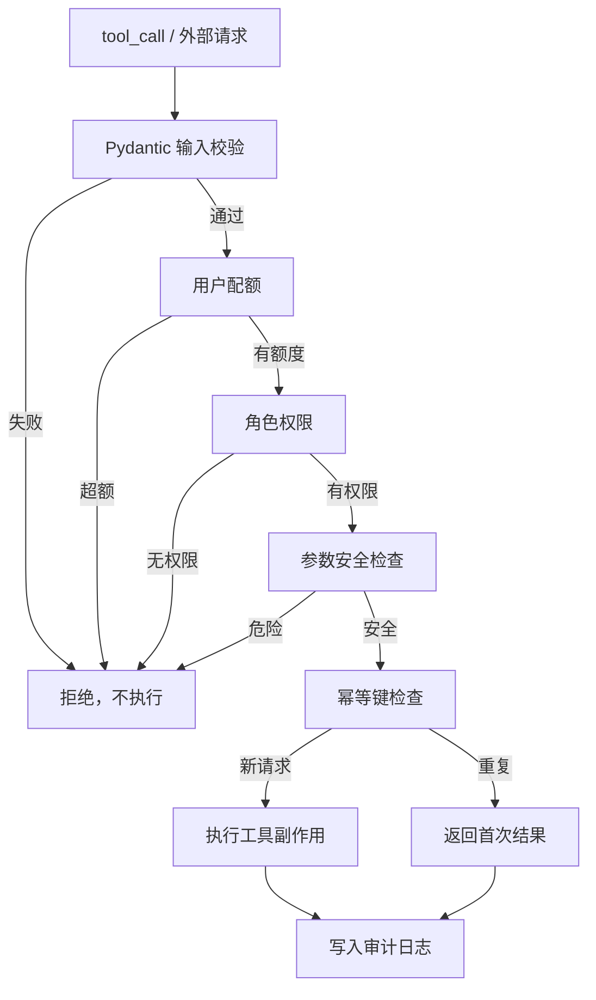

# LangChain Day12：配置、安全、部署与生产运行

## 1. 今天完成了什么

Day11 解决“如何证明系统正确”，Day12 解决“系统如何安全运行”：

- 配置读取与校验；
- API Key、Token 和密码脱敏；
- Pydantic 输入校验；
- 角色权限和工具参数检查；
- SQLite 授权审计；
- 用户级和角色级请求配额；
- 幂等键保护副作用工具；
- liveness/readiness 健康检查；
- 优雅停机和资源释放；
- 安全工具网关整合。

## 2. 练习文件

| 顺序 | 文件 | 重点 |
|---|---|---|
| 1 | `day12_config_basic.py` | 环境变量、配置校验、密钥脱敏 |
| 2 | `day12_logging_redaction.py` | JSON 日志和递归脱敏 |
| 3 | `day12_input_validation.py` | Pydantic 输入契约 |
| 4 | `day12_permission_basic.py` | 角色权限和工具参数 |
| 5 | `day12_permission_audit.py` | SQLite 授权审计 |
| 6 | `day12_user_quota.py` | 用户和角色请求配额 |
| 7 | `day12_idempotency.py` | 幂等键和副作用保护 |
| 8 | `day12_health_check.py` | liveness 和 readiness |
| 9 | `day12_graceful_shutdown.py` | 优雅停机 |
| 10 | `day12_secure_tool_gateway.py` | 全部安全层整合 |

## 3. 最终安全数据流



任意安全层失败，都不能绕过网关执行高风险工具。

## 4. 配置与日志安全

`day12_config_basic.py` 从 `.env` 或系统环境变量读取：

```text
DEEPSEEK_MODEL
DEEPSEEK_API_KEY
DEEPSEEK_BASE_URL
LLM_TIMEOUT
LLM_MAX_RETRIES
APP_ENV
```

配置流程：

```text
环境变量 → load_dotenv() → AppConfig
                         ├─ 缺少/格式错误 → ConfigError
                         └─ 校验成功 → 创建模型
```

API Key 可以传给模型客户端，但不能直接打印。日志使用 `SensitiveDataFilter` 和 `JsonFormatter`：

```text
字段名 api_key/password/token → 按字段脱敏
文本 sk-.../Bearer ...       → 按模式脱敏
嵌套dict/list                → 递归脱敏
```

脱敏函数处理副本，避免修改原始业务数据。

## 5. 输入校验

`day12_input_validation.py` 使用 Pydantic 建立入口契约：

```python
ConfigDict(
    extra="forbid",
    str_strip_whitespace=True
)
```

它限制问题长度、请求编号格式、控制字符和未知字段。校验必须发生在进入模型或工具之前：

```text
外部dict → model_validate() → 失败立即拒绝 / 成功进入Prompt或Tool
```

## 6. 角色权限、参数检查与审计

角色能力：

| 角色 | 能力 |
|---|---|
| `user` | 查询 |
| `operator` | 查询、发起转账审批 |
| `admin` | 查询、发起审批、批准转账 |

模型可以提出 `tool_calls`，但 Python 必须先执行：

```python
PermissionPolicy.check(identity, request)
```

权限检查分两层：

```text
角色是否能使用工具？
参数是否安全？
```

`day12_permission_audit.py` 把每次批准和拒绝保存到：

```text
day12/database/day12_permission_audit.db
```

审计记录包括：

```text
request_id、时间、user_id、role、tool_name、参数摘要、decision、reason
```

## 7. 用户配额

Day10 的 `InMemoryRateLimiter` 控制全局请求速率，`day12_user_quota.py` 进一步按用户和角色限制窗口配额：

```text
user      → 每60秒3次
operator  → 每60秒5次
admin     → 每60秒10次
```

计数键是 `user_id`，不同用户互不影响。生产多进程部署时，应把计数放入 Redis 等共享存储。

## 8. 幂等性

`day12_idempotency.py` 保护转账、下单、发消息等副作用工具：

```text
幂等键不存在 → 执行一次并保存结果
幂等键存在且参数相同 → 返回首次结果
幂等键存在但参数不同 → 拒绝冲突
```

网络超时后模型可能重复请求工具；幂等键保证重复请求不会重复产生副作用。

## 9. 健康检查与优雅停机

`day12_health_check.py` 区分：

```text
liveness  → 进程是否还活着，失败通常重启
readiness → 是否准备好接收流量，失败时暂缓流量
```

健康检查只验证配置、数据库和地址格式，不应每次主动调用真实模型。

`day12_graceful_shutdown.py` 的停机顺序：

```text
停止新请求 → 等待活跃请求 → 关闭数据库 → 关闭模型客户端 → 退出
```

只有 `active_requests == 0` 时才允许关闭底层资源。

## 10. 最终安全工具网关

`day12_secure_tool_gateway.py` 把所有规则串起来：

```text
原始tool_call
    → 输入结构校验
    → 用户配额
    → 角色权限
    → 工具参数
    → 幂等键
    → 执行工具
    → 审计日志
```

测试结果证明：合法操作可以执行，重复转账只产生一次副作用，越权和额外字段都会被拒绝。

核心原则：

```text
模型提出工具调用 ≠ 工具一定执行
```

模型只能表达意图，最终执行权属于 Python 安全网关。

## 11. 常见易错点

1. 把 API Key 直接打印到日志。
2. 只脱敏顶层字段，不处理嵌套参数。
3. 只检查角色，不检查金额等工具参数。
4. 只记录批准，不记录拒绝。
5. 把全局限流误认为用户配额。
6. 对有副作用的工具重试，却没有幂等键。
7. 同一个幂等键被修改参数后仍然执行。
8. readiness 检查每次主动请求真实模型。
9. 停机时立即关闭数据库，不等待活跃请求。
10. 只依赖提示词安全，不在 Python 中强制检查。
11. 多进程部署时继续使用单进程内存配额和熔断状态。

## 12. Day12 核心结论

```text
配置校验 → 防止错误启动
日志脱敏 → 防止秘密泄露
输入校验 → 防止非法数据进入系统
角色权限 → 防止越权调用工具
审计日志 → 记录安全决定
用户配额 → 防止单个用户耗尽资源
幂等控制 → 防止副作用重复执行
健康检查 → 让平台知道服务状态
优雅停机 → 让部署重启不丢请求
安全网关 → 统一落实所有规则
```

安全运行的口诀：

```text
默认拒绝，明确授权；
先校验，再执行；
先记录，再放行；
失败可恢复，副作用不可重复。
```
