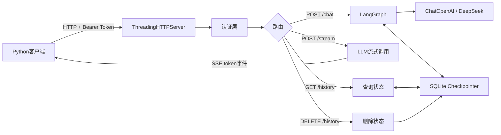

# LangChain Day13：HTTP API、服务接口与部署实践

## 今日成果

Day13 将终端程序封装成 HTTP 服务，并逐步加入：JSON 接口、真实模型调用、`thread_id` 多轮记忆、SQLite 持久化、历史查询与删除、Bearer Token 认证、SSE 流式回答、环境变量配置、优雅退出、Docker 配置、冒烟测试和端到端验收。

## 最终架构



## 最终接口

| 方法 | 路径 | 认证 | 用途 |
|---|---|---|---|
| GET | `/health` | 不需要 | 检查服务是否存活 |
| POST | `/chat` | Bearer Token | 普通多轮问答 |
| POST | `/stream` | Bearer Token | SSE 流式问答 |
| GET | `/history?thread_id=...` | Bearer Token | 查询会话历史 |
| DELETE | `/history?thread_id=...` | Bearer Token | 删除会话历史 |

## 普通聊天数据流

```text
客户端字典 → json.dumps() → POST /chat
→ Bearer认证 → JSON解析和校验
→ thread_id构造config → SqliteSaver读取历史
→ graph.invoke() → llm.invoke() → AIMessage
→ SqliteSaver保存状态 → JSON响应 → 客户端json.loads()
```

## 记忆和持久化

```python
config = {"configurable": {"thread_id": thread_id}}
```

相同 `thread_id` 继续同一会话，不同 `thread_id` 使用不同历史。`InMemorySaver` 在服务关闭后丢失数据；`SqliteSaver` 将检查点写入磁盘，重启后仍能恢复。

## 认证

受保护接口要求：

```http
Authorization: Bearer <DAY13_API_KEY>
```

服务端从 `.env` 读取令牌，使用 `hmac.compare_digest()` 比较。认证失败返回 `401 Unauthorized`。健康检查不涉及用户数据，因此保持公开。

## SSE 流式响应

响应类型为 `text/event-stream`，事件示例：

```text
event: token
data: {"delta":"LangGraph"}

event: done
data: {"request_id":"req-123"}
```

模型每生成一段就写入 `wfile`，`flush()` 使内容立即发送。

## HTTP 状态码

| 状态码 | 含义 |
|---:|---|
| 200 | 请求成功 |
| 400 | JSON或请求格式错误 |
| 401 | 认证失败 |
| 404 | 接口或会话不存在 |
| 411 | 缺少 Content-Length |
| 413 | 请求体过大 |
| 422 | 字段校验失败 |
| 502 | 上游模型调用失败 |

## 部署配置

```text
DAY13_API_KEY=服务令牌
HTTP_HOST=127.0.0.1
HTTP_PORT=8000
```

本机学习监听 `127.0.0.1`；容器通常监听 `0.0.0.0`。部署入口处理 `SIGINT` 和 `SIGTERM`，退出时关闭 HTTP 端口和 SQLite 连接。

## 测试层次

- 冒烟测试不调用模型，检查服务、认证、校验和数据库边界。
- 端到端测试调用模型两次，检查真实问答、记忆、持久化和删除。

## 常用命令

```bash
python day13/python/day13_deploy_api.py
python day13/python/day13_http_stream_client.py
python day13/python/day13_api_smoke_test.py
python day13/python/day13_api_acceptance_test.py
```

## Docker 状态

Docker 已安装，Dockerfile、依赖清单、健康检查和数据卷配置已经完成。实际构建因连接 Docker Hub 超时而暂停，不是 Python 代码错误。网络恢复后继续：

```bash
sudo docker pull python:3.12-slim
sudo docker build -t day13-api day13
```

## 核心结论

1. HTTP API 把程序能力暴露给其他程序。
2. `thread_id` 决定读取和写入哪份对话状态。
3. SQLite 让状态跨进程重启保存。
4. 认证和输入校验必须在调用模型之前执行。
5. SSE 让用户更早看到模型输出。
6. 密钥应通过环境变量注入，不能写入镜像或 Git。
7. 冒烟测试验证基本可用，端到端测试验证完整业务链路。
