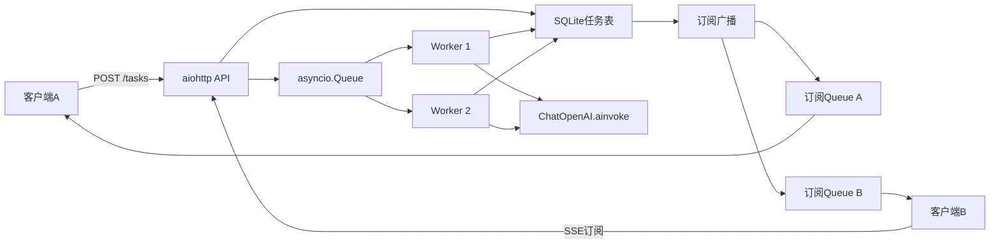

# LangChain Day14：异步调用、并发控制与后台任务

## 一、今日学习成果

Day14 从 `asyncio` 基础开始，逐步完成：

1. 同步等待与异步等待对比；
2. `ChatOpenAI.ainvoke()`；
3. 多模型请求并发；
4. `Semaphore` 最大并发限制；
5. 超时与异常隔离；
6. 异步重试和指数退避；
7. `asyncio.Queue` 后台Worker；
8. aiohttp后台任务API；
9. 运行中任务取消；
10. SQLite任务持久化与重启恢复；
11. 客户端局部状态；
12. SSE主动状态推送；
13. 多订阅者广播。

## 二、最终架构



## 三、同步与异步

同步等待会阻塞当前线程：

```python
time.sleep(1)
```

异步等待会把执行权交还事件循环：

```python
await asyncio.sleep(1)
```

三个1秒I/O任务同步执行约3秒，并发等待约1秒。异步不会加速单个请求，而是让多个等待时间重叠。

## 四、协程、Task和事件循环

```text
async def函数调用 → coroutine
asyncio.create_task(coroutine) → Task
asyncio.run(main()) → 创建和关闭事件循环
await → 暂停当前协程，让事件循环调度其他任务
```

`asyncio.gather()` 等待全部任务，并按传入顺序返回结果；完成顺序可以不同。

## 五、并发限制

```python
semaphore = asyncio.Semaphore(2)

async with semaphore:
    await llm.ainvoke(...)
```

Task可以创建很多，但同一时刻最多两个进入模型调用区域。后台队列中，Worker数量也可以自然形成并发上限。

## 六、超时与异常隔离

```python
await asyncio.wait_for(operation(), timeout=10)
```

超时会取消被等待的协程并抛出 `TimeoutError`。每个任务内部把成功、超时和错误转换成统一结果，可防止一个失败任务破坏整个 `gather()`。

## 七、异步重试

只重试临时错误，不重试参数等永久错误。指数退避公式：

```python
delay = base_delay * (2 ** (attempt - 1))
```

异步等待必须使用：

```python
await asyncio.sleep(delay)
```

不能使用会阻塞事件循环的 `time.sleep()`。

## 八、后台任务队列

```text
提交任务 → 生成task_id → pending → 放入Queue → 立即返回202
Worker取出 → running → ainvoke → succeeded/failed
```

`Queue`负责调度，任务存储负责查询状态。每次 `get()` 必须对应一次 `task_done()`；`join()` 在所有项目完成后被唤醒。

## 九、取消语义

```text
pending + DELETE → cancelled，不调用模型
running + DELETE → task.cancel() → CancelledError → cancelled
已经结束 + DELETE → 409 Conflict
```

取消是协作协议，不是强制杀死。取消本地协程也不保证远端模型立即停止或停止计费。

服务关闭导致的中断与用户取消不同：

```text
用户取消 → cancelled，不恢复
服务关闭 → pending，重启后重新排队
```

## 十、服务端持久化

```text
SQLite：任务状态的权威来源
asyncio.Queue：当前进程调度结构
running_operations：当前运行中的Task
```

重启时，将遗留的 `pending/running` 恢复成 `pending` 并重新放入Queue。这是简单的“至少执行一次”策略，极端崩溃窗口中可能重复执行。

## 十一、客户端局部状态

客户端保存：

- `task_id`；
- 问题摘要；
- 最后已知状态；
- 最后同步时间。

服务端保存完整问题、权威状态、回答、错误和时间。客户端缓存面向用户体验，服务端数据库才是业务事实来源。

## 十二、轮询与主动通知

HTTP轮询简单可靠，但会产生重复GET并有更新延迟。SSE建立一条长连接，由服务端在状态变化后主动推送。

```text
Worker → SQLite commit → Event/Queue通知 → SSE协程 → 客户端
```

通知必须在数据库提交之后发送，避免客户端被唤醒后仍读到旧状态。

## 十三、多订阅者广播

每个订阅客户端拥有独立Queue：

```text
task-123
├── Queue A → 浏览器A
├── Queue B → 浏览器B
└── Queue C → 手机C
```

一次状态更新会复制给所有Queue。某个客户端慢或断开，不应影响其他订阅者。

## 十四、常用运行命令

持久化任务API：

```bash
python day14/python/day14_task_persistent_api.py
```

多订阅广播API：

```bash
python day14/python/day14_task_broadcast_api.py
```

提交并订阅：

```bash
python day14/python/day14_task_sse_client.py
```

观察已有任务：

```bash
python day14/python/day14_task_watch_client.py task-xxxxxxxxxxxx
```

客户端局部索引：

```bash
python day14/python/day14_client_local_state.py
```

## 十五、核心结论

1. 异步适合I/O等待，不会直接加速CPU计算。
2. 创建大量Task不代表应该允许无限并发。
3. 超时、重试和取消必须有清晰状态语义。
4. Queue负责调度，SQLite负责持久化，两者不能相互替代。
5. 客户端局部状态服务于体验，服务端状态是权威来源。
6. SSE适合服务器向客户端单向推送任务状态。
7. 单进程广播可用独立Queue；跨进程广播需要Redis等外部消息系统。
