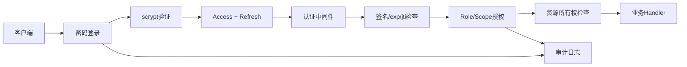

# LangChain Day15：多用户认证、授权与数据隔离

## 学习成果

Day15 完成了签名令牌、持久密钥、HTTP认证中间件、用户任务隔离、Role与Scope授权、令牌撤销、Refresh Token轮换、scrypt密码验证、登录锁定和安全审计。

## 完整安全链路



## 认证、授权与所有权

```text
Authentication：令牌是真的吗？请求者是谁？
Authorization：该身份具备所需Role/Scope吗？
Ownership：具体资源属于当前用户吗？
```

任务查询必须同时匹配：

```sql
WHERE task_id = ? AND user_id = ?
```

越权查询返回404，避免泄露资源是否存在。

## 签名令牌

教学令牌结构为 `payload.signature`。载荷可见，签名只防篡改、不加密。主要字段：

- `sub`：用户身份；
- `iat`：签发时间；
- `exp`：过期时间；
- `jti`：令牌唯一编号；
- `role/scopes`：授权信息。

密钥从 `.env` 的 `DAY15_TOKEN_SECRET` 读取。修改密钥会使旧令牌全部失效。

## Role与Scope

Role是权限集合名称，Scope是接口需要的具体能力：

```text
admin → task:create + task:read:any + task:delete:any
auditor → task:read:any
user → task:create + task:read:own
```

接口检查Scope而不是硬编码角色名称，更灵活且符合最小权限原则。

## Access与Refresh Token

```text
Access Token：短期、频繁访问API、签名验证
Refresh Token：长期、只用于换证、服务端保存摘要
```

刷新时旧Refresh立即标记已使用并签发新令牌对。旧令牌再次出现会被识别为重放。数据库只保存SHA-256摘要，不保存Refresh原文。

## 密码安全

注册：

```text
password + random salt → scrypt → password_hash
```

登录时使用保存的Salt和参数重新派生，再用 `compare_digest()` 比较。数据库不保存密码原文。不存在的用户也执行一次模拟scrypt，减少账号枚举时间差。

## 登录保护

连续失败达到阈值后返回429并设置 `Retry-After`。锁定状态保存在SQLite中，服务重启不会清零。成功登录后失败计数归零。

## 令牌撤销

`jti`写入撤销表后，即使签名正确且尚未过期，后续请求仍返回401。撤销记录只需保存到令牌自然过期。

## 安全审计

记录登录成功、失败和锁定，包括UTC时间、用户、来源IP、结果与原因。绝不记录密码、Access Token、Refresh Token或签名密钥。

## 状态码

| 状态码 | 含义 |
|---:|---|
| 200 | 成功 |
| 401 | 未认证、令牌无效/撤销、密码错误 |
| 403 | 已认证但权限不足 |
| 404 | 资源不存在或不属于当前用户 |
| 422 | 输入格式错误 |
| 429 | 登录尝试过多、账号临时锁定 |

## 核心结论

1. 不相信客户端提交的 `user_id`、Role或Scope。
2. 身份和权限必须处于签名保护范围。
3. 普通查询必须强制加入所有权条件。
4. 短期Access与可轮换Refresh兼顾体验和安全。
5. 密码使用专用慢哈希，不能明文或普通SHA保存。
6. 撤销、锁定和审计都需要服务端状态。
7. 日志必须有用，但绝不能泄露凭证。
