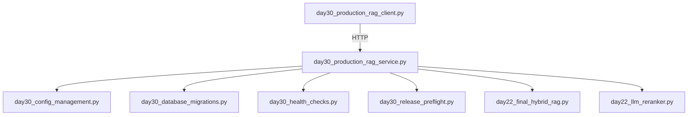
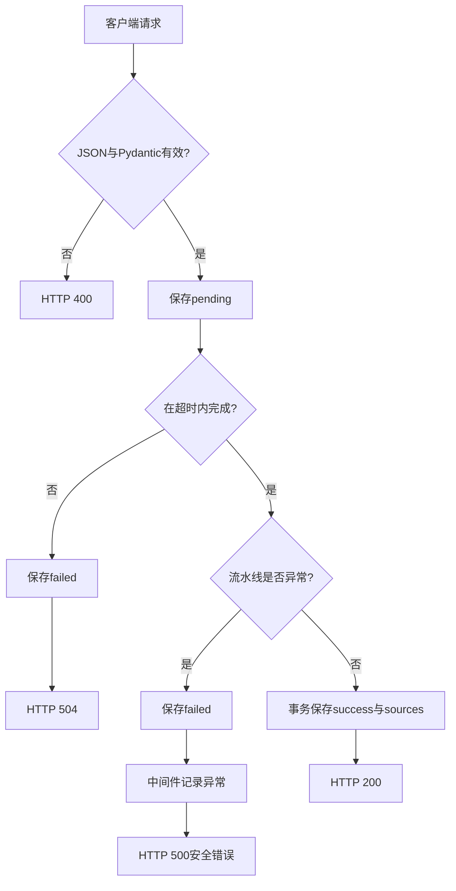

# Day30 最终代码详细解读

本文重点解读：

- `day30_production_rag_service.py`
- `day30_production_rag_client.py`

同时说明它们如何调用 Day30 前五步和 Day22 的检索模块。

---

## 一、模块依赖关系



最终服务没有重新复制前面已经完成的逻辑，而是导入并复用它们。这体现了模块化：每个文件只负责一类问题。

---

## 二、常量与请求模型

### `PROJECT_ROOT` 和 `DAY22_PYTHON`

```python
PROJECT_ROOT = Path(__file__).resolve().parents[2]
DAY22_PYTHON = PROJECT_ROOT / "day22" / "python"
```

当前脚本在 `day30/python` 下，向上两层得到项目根目录。随后把 Day22 的 Python 目录加入 `sys.path`，从而复用混合检索和 Reranker。

### `AskRequest`

```python
class AskRequest(BaseModel):
    model_config = ConfigDict(extra="forbid")
    question: str = Field(min_length=1, max_length=2000)
```

作用：

- `question` 必须是字符串；
- 长度在 1 到 2000 之间；
- `extra="forbid"` 拒绝未定义字段；
- 不让任意 JSON 直接流入 RAG 流水线。

注意：Pydantic 的 `min_length=1` 仍允许一个空格，因此 handler 里还会执行 `strip()` 后再次检查。

---

## 三、配置加载

### `empty_config_arguments()`

第1步的 `load_config()` 要求接收一个 `argparse.Namespace`。最终服务没有额外开放配置参数，所以构造字段全部为 `None` 的 Namespace。

`None` 不会覆盖配置，最终仍遵守：

```text
默认值 < app.json < .env < 系统环境变量
```

### 为什么模型客户端最后才取得真实密钥

```python
api_key=config.api_key.reveal()
```

在此之前，打印配置或生成健康报告只会看到 `********`。真实值只在创建 `ChatOpenAI` 的边界处短暂取出。

---

## 四、启动前检查

### `run_required_preflight(config)`

它调用五类必须检查：

1. 依赖包；
2. 数据库完整性与版本；
3. 迁移历史和 checksum；
4. 最新备份；
5. 数据目录写权限。

每项函数返回：

```python
tuple[str, str]
```

第一个字符串是 `PASS/WARN/FAIL`，第二个字符串是说明。

只要存在 `FAIL` 就抛出 `RuntimeError`，`main()` 将进程以退出码 1 结束，因此端口根本不会开始监听。

这叫 fail fast：问题越早暴露，越不容易在接收用户流量后才出故障。

---

## 五、数据库访问层

### `open_business_database(config)`

每次后台数据库操作建立一个短连接，并设置：

```text
row_factory = sqlite3.Row
foreign_keys = ON
busy_timeout = 5000
```

- `Row` 让查询结果既支持下标又支持字段名；
- 外键确保 `rag_sources.request_id` 必须指向真实请求；
- busy timeout 让 SQLite 短暂繁忙时等待，而不是立即失败。

### `create_request_record()`

模型调用前先插入：

```text
status = pending
answer = NULL
```

这样即使进程中途崩溃，数据库里仍能看见未完成请求，而不会完全失去痕迹。

### `complete_request_record()`

回答和来源在同一个事务中写入：

```text
BEGIN IMMEDIATE
→ rag_requests改成success
→ 批量插入rag_sources
→ COMMIT
```

如果来源写入失败，回答状态也会回滚，不会出现“显示成功但来源没保存”的半完成状态。

### `fail_request_record()`

超时或流水线异常时，将请求改成 `failed`，并保存对用户安全的公开错误描述，不把内部堆栈写进回答字段。

### 为什么数据库函数放入 `asyncio.to_thread()`

标准 `sqlite3` 是同步接口。如果直接在异步 handler 中运行较慢查询，会阻塞整个事件循环。

```python
await asyncio.to_thread(database_function, ...)
```

会把同步数据库工作交给线程池，事件循环可以继续处理其他连接。

---

## 六、RAG流水线

### `execute_rag_pipeline()` 返回类型

```python
tuple[str, list[dict[str, Any]], dict[str, int]]
```

三个返回值依次是：

1. 最终回答字符串；
2. 合格来源列表；
3. 回答模型的 Token 统计。

### 第一步：混合召回

```python
rrf_results, diagnostics = retrieve_rrf_candidates(question)
```

Day22 模块内部执行：

```text
问题
├─ 向量语义检索
└─ FTS5关键词检索
        ↓
      RRF融合
```

该函数是同步函数，所以使用 `asyncio.to_thread()`。

### 第二步：LLM Reranker

```python
reranked_results, _ = rerank_candidates(question, rrf_results)
```

RRF 擅长广泛召回，Reranker 进一步阅读问题与候选正文，给出更精细的相关性分数。

### 第三步：阈值守门

```python
item.relevance_score >= RERANK_THRESHOLD
```

当前阈值 95 来自 Day22 的评测结果，而不是凭感觉设置。

没有资料达标时，程序直接返回“知识库中没有足够可靠的资料”，不会让回答模型凭自身知识自由发挥。

### 第四步：构造证据

`build_evidence_text()` 把每个来源转换为：

```text
[资料1]
来源：...
正文：...
```

稳定编号既方便模型引用，也方便用户核对。

### 第五步：模型回答

系统消息明确约束：

- 只能使用参考资料；
- 不得使用外部知识；
- 关键结论标注 `[资料N]`；
- 资料不足必须拒绝。

`llm.ainvoke()` 是异步模型调用。网络等待期间，事件循环可以继续服务其他 HTTP 请求。

---

## 七、中间件

### `request_context_middleware`

中间件包围所有路由：

```text
请求进入
→ 生成request_id
→ 提取或生成trace_id
→ 调用真正handler
→ 记录状态码与耗时
→ 请求结束
```

### request_id 与 trace_id

`request_id`：

- 标识本服务收到的一次请求；
- 由服务端生成，避免客户端重复 ID 与数据库主键冲突；
- 用于 `/requests/{request_id}` 查询。

`trace_id`：

- 用于串联跨服务调用；
- 当前允许从 `X-Trace-ID` 传入；
- 缺失或长度异常时生成新值。

### `finally` 中记录日志

无论请求成功还是抛出异常，`finally` 都会执行，因此可以稳定记录：

- method；
- path；
- status；
- duration；
- request_id；
- trace_id。

---

## 八、`POST /ask`

`ask_handler()` 是核心业务入口：

1. 读取 JSON；
2. Pydantic 校验；
3. `strip()` 后检查问题；
4. 保存 pending 记录；
5. 等待 Semaphore；
6. 进入总超时上下文；
7. 执行 RAG；
8. 保存回答与来源；
9. 返回公开来源和 Token。

### 并发限制

```python
async with request.app["pipeline_semaphore"]:
```

HTTP连接数量可以很多，但同时运行昂贵检索和模型流水线的数量不会超过 `max_concurrency`。

### 总超时

```python
async with asyncio.timeout(config.request_timeout_seconds):
```

它限制整个检索、精排和回答过程，而不只是单次网络连接。

### 异常路径

```text
TimeoutError
→ 数据库状态改为failed
→ HTTP 504

其他异常
→ 数据库状态改为failed
→ 交给中间件
→ HTTP 500且不泄露内部细节
```

---

## 九、查询和运维接口

### `/requests/{request_id}`

先查询 `rag_requests`，再查询对应 `rag_sources`，最终组合成一个 JSON 对象。

这是业务级审计入口：可以核对某次请求的问题、回答、状态、Trace 和引用来源。

### `/ops/status`

返回：

- 不同请求状态的数量；
- 最近10条请求；
- 环境名；
- 模型名；
- 最大流水线并发数。

它展示聚合运维信息，不返回 API 密钥和完整知识正文。

### 健康接口

最终服务直接复用第3步的 handler：

```text
/livez
/readyz
/health/dependencies
```

---

## 十、`create_app(config)`

该函数负责依赖装配：

```text
AppConfig
→ aiohttp Application
→ middleware
→ ChatOpenAI
→ Semaphore
→ routes
```

把创建过程封装成函数有两个优点：

- 测试时可以创建 App 而不真正监听端口；
- 依赖关系集中，避免散落在全局代码中。

`client_max_size=32 * 1024` 限制请求正文大小。问题字段虽然只有2000字符，HTTP层也应有整体大小上限。

---

## 十一、`main()` 启动流程

```text
load_config
→ configure_logging
→ migrate_database
→ run_required_preflight
→ create_app
→ web.run_app
```

迁移先执行，Preflight 再验证迁移结果。任何必须项失败，程序都在绑定端口前退出。

---

## 十二、客户端代码

### 为什么使用 urllib

客户端只依赖 Python 标准库，不要求系统安装 `curl`，也不额外依赖 `requests`。

### `request_json()`

参数：

```python
method: str
path: str
payload: dict | None
```

返回：

```python
tuple[int, dict]
```

它统一完成：

- JSON编码；
- Content-Type设置；
- HTTP请求；
- JSON响应解析；
- HTTP错误响应解析。

### 客户端验证顺序

```text
GET /livez
→ GET /readyz
→ ready不是200则停止
→ POST /ask
→ 取得request_id
→ GET /requests/{request_id}
→ GET /ops/status
```

客户端先确认就绪再发送昂贵模型请求，这是良好的调用习惯。

---

## 十三、一次请求中的主要数据类型

| 变量 | 数据类型 | 作用 |
|---|---|---|
| `raw_body` | `Any`，通常是 `dict` | 尚未信任的客户端JSON |
| `payload` | `AskRequest` | 已经过Pydantic校验的请求 |
| `question` | `str` | 清理空白后的问题 |
| `rrf_results` | `list[RRFResult]` | 两路检索融合候选 |
| `reranked_results` | `list[RerankedResult]` | 模型精排候选 |
| `sources` | `list[dict[str, Any]]` | 达到阈值的证据 |
| `response` | `AIMessage` | LangChain模型返回消息 |
| `usage` | `dict[str, int]` | 输入、输出和总Token |
| `answer` | `str` | 返回用户并保存数据库的回答 |
| `request_id` | `str` | 一次本服务请求编号 |
| `trace_id` | `str` | 调用链编号 |

---

## 十四、完整错误传播关系



---

## 十五、目前仍可继续增强的地方

本代码已经适合作为生产化学习样板，但真实大型系统还会进一步加入：

- PostgreSQL代替单机SQLite；
- Redis或消息队列；
- 标准 W3C `traceparent` 和 OpenTelemetry；
- 身份认证与细粒度权限；
- 分布式限流；
- 独立迁移工具和回滚发布策略；
- 多副本部署与负载均衡；
- 指标告警和低频模型合成监控；
- 密钥管理服务；
- 自动备份到异地对象存储。

学习时最重要的不是一次堆满组件，而是理解当前每一层解决了什么具体风险。

---

## 十六、最终心智模型

```text
安全配置决定程序如何运行
        ↓
数据库迁移保证代码和Schema兼容
        ↓
Preflight决定服务能否启动
        ↓
健康检查决定实例能否接收流量
        ↓
输入校验保护业务边界
        ↓
Semaphore与Timeout保护有限资源
        ↓
检索、精排和守门保护回答相关性
        ↓
数据库记录保护可追溯性
        ↓
备份与恢复保护数据可恢复性
        ↓
日志和运维接口帮助定位问题
```

Day30 的真正主题是：

> 把“能运行的代码”变成“知道如何安全启动、如何判断健康、如何定位请求、如何恢复数据的服务”。

