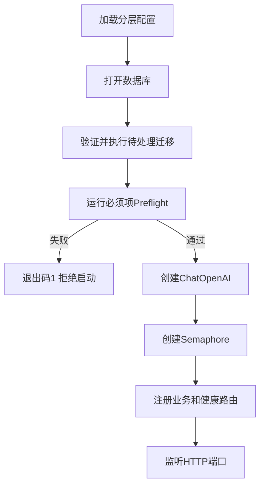
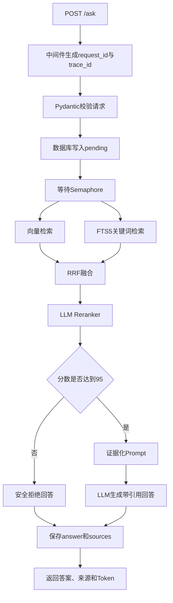
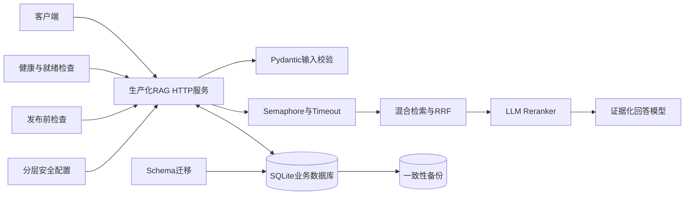

# LangChain 学习 Day30：生产化收尾与发布验收

## 今日目标

Day30 不再增加新的 Agent 或 RAG 算法，而是把已经能运行的程序整理成一个更接近生产环境的服务。

今天解决的核心问题是：

> 一个 RAG 程序除了“能够回答问题”，还需要怎样才能安全、稳定、可恢复地运行？

今日固定完成 7 步：

1. 配置分层、类型校验与密钥隔离
2. 数据库 Schema 版本与迁移
3. 存活、就绪与依赖健康检查
4. 数据库备份、校验与恢复演练
5. 启动前检查和发布验收清单
6. 最终生产化 RAG 服务与运维入口
7. 总结笔记与最终代码详细解读

---

## 第1步：配置管理

文件：`day30/python/day30_config_management.py`

### 配置覆盖顺序

后加载的层可以覆盖前面的层：

```text
代码默认值
→ app.json
→ 项目根目录.env
→ 系统环境变量
→ 命令行参数
```

这种设计兼顾了不同场景：

- 默认值让程序开箱可用；
- JSON 保存普通、可提交到版本库的配置；
- `.env` 保存本机开发密钥；
- 系统环境变量适合容器和服务器部署；
- 命令行参数适合单次启动覆盖。

### SecretValue

`SecretValue` 默认只显示 `********`，只有显式调用 `reveal()` 才能取得真实值。

它不能从根本上阻止进程内代码读取密钥，但可以降低这些意外泄露：

- `print(config)`；
- 日志记录配置对象；
- 调试器显示对象；
- 错误报告序列化配置。

### 配置来源追踪

`provenance` 记录每个最终字段来自哪一层。排查“为什么服务器使用了这个端口或模型”时，不需要猜测。

---

## 第2步：数据库迁移

文件：`day30/python/day30_database_migrations.py`

### 为什么需要迁移

程序升级后，代码期望的表结构可能发生变化。如果直接修改数据库：

- 不知道某个环境改到了哪个版本；
- 同一条 `ALTER TABLE` 可能重复执行；
- 修改到一半失败会留下不完整结构；
- 多台服务器可能拥有不同结构。

因此把每次结构变化写成按版本排序的 `Migration`：

```text
v1 创建rag_requests
v2 增加trace_id
v3 创建rag_sources
```

### schema_migrations

该表记录：

- `version`：迁移版本；
- `name`：迁移名称；
- `checksum`：SQL内容的 SHA-256；
- `applied_at`：执行时间；
- `execution_ms`：执行耗时。

### 为什么迁移需要 checksum

已经执行过的迁移文件不能悄悄修改。否则旧数据库执行的是旧 SQL，新数据库执行的是新 SQL，但双方都声称自己是同一个版本。

正确处理方式是：

> 已发布迁移保持不变，需要修改时新增下一个版本。

### 原子事务

```text
BEGIN IMMEDIATE
→ 执行所有Schema SQL
→ 写入schema_migrations
→ 更新PRAGMA user_version
→ COMMIT
```

任何一步失败就执行 `ROLLBACK`。结构变化与版本记录必须共同成功或共同失败。

---

## 第3步：健康检查

文件：`day30/python/day30_health_checks.py`

### live、ready和dependency的区别

| 接口 | 回答的问题 | 是否检查依赖 | 失败后的典型动作 |
|---|---|---:|---|
| `/livez` | 进程是否还活着 | 否 | 重启进程 |
| `/readyz` | 是否可以接收流量 | 是 | 暂停转发流量 |
| `/health/dependencies` | 具体哪项依赖异常 | 是，且显示细节 | 供开发和运维排查 |

`/livez` 不应该因为数据库暂时不可用而失败。否则编排系统可能不断重启一个本身正常、只是依赖短暂波动的进程。

`/readyz` 的作用则是保护用户：数据库或 Schema 不可用时，负载均衡器不应继续把新流量转给该实例。

### 为什么没有真实调用模型

频繁健康检查如果每次都请求大模型，会产生：

- Token费用；
- 上游限流；
- 健康检查自身放大故障；
- 模型短暂波动导致实例频繁上下线。

因此当前关键检查只验证模型配置。真实模型质量和连接状态应由低频合成监控单独验证。

---

## 第4步：备份与恢复演练

文件：`day30/python/day30_database_backup.py`

### 为什么不直接复制 SQLite 文件

运行中的 SQLite 可能使用 WAL，最新事务不一定只在主 `.db` 文件中。直接复制可能得到不一致快照。

本步使用 SQLite Online Backup API：

```text
运行中的SQLite
→ SQLite Backup API
→ 同目录临时文件
→ os.replace原子发布
```

### 备份清单

每份 `.db` 备份对应一个 `.manifest.json`，记录：

- 创建时间；
- 源数据库路径；
- 备份文件名；
- 文件大小；
- SHA-256；
- Schema版本；
- 关键表行数。

### 备份存在不等于能恢复

真正可靠的流程是：

```text
创建备份
→ 校验哈希
→ PRAGMA integrity_check
→ 恢复到隔离目录
→ 对比Schema和行数
→ 执行一次隔离写入
→ 确认正式数据库没变化
```

只有定期完成恢复演练，才能证明备份可用。

---

## 第5步：发布前检查

文件：`day30/python/day30_release_preflight.py`

### 检查项

1. Python运行时；
2. Python依赖包；
3. 类型化配置和密钥；
4. 环境发布策略；
5. `.env` 权限；
6. 数据库完整性和 Schema；
7. 迁移历史和 checksum；
8. 最新备份有效性；
9. 数据目录写权限；
10. 服务监听参数。

### PASS、WARN和FAIL

```text
PASS → 检查通过
WARN → 存在风险，但普通模式仍可启动
FAIL → 必须项失败，禁止启动
```

普通模式中，警告不会阻止本地练习；`--strict` 模式会把警告也视为发布阻断条件。

退出码可以直接交给 Shell、systemd、Docker 或 CI/CD：

```text
0 → 继续发布或启动
1 → 阻止发布
2 → 配置甚至无法加载
```

---

## 第6步：最终生产化 RAG 服务

服务端：`day30/python/day30_production_rag_service.py`

客户端：`day30/python/day30_production_rag_client.py`

### 启动流程



### 单次 RAG 请求



### 关键生产特性

- 请求输入由 Pydantic 校验；
- 服务端生成唯一 `request_id`；
- 每次请求拥有 `trace_id`；
- Semaphore 限制昂贵流水线的并发；
- `asyncio.timeout()` 限制总处理时间；
- 同步检索和 SQLite 操作通过 `asyncio.to_thread()` 避免阻塞事件循环；
- 请求状态按 `pending/success/failed` 持久化；
- 来源单独保存到 `rag_sources`；
- 日志不记录密钥和完整知识库正文；
- 健康接口与业务接口分离；
- `/ops/status` 提供最近请求和状态统计。

---

## Day30总体架构



---

## 今日必须掌握的结论

1. 配置必须分层，并且密钥不能进入普通配置文件和日志。
2. 数据库结构变化必须版本化、可校验、可回滚。
3. “进程活着”和“服务可以接流量”是两个不同问题。
4. 备份必须包含完整性校验和恢复演练。
5. 发布前检查应该用退出码自动阻断危险启动。
6. 生产服务要控制并发、超时、输入、错误和数据持久化。
7. `request_id` 用于定位一次请求，`trace_id` 用于串联一次调用链。
8. RAG生产化不只是检索与生成，还包括配置、数据库、恢复、健康、观测和运维。

---

## 复习命令

```bash
# 1. 配置检查
python day30/python/day30_config_management.py

# 2. 数据库迁移
python day30/python/day30_database_migrations.py

# 3. 健康检查
python day30/python/day30_health_checks.py

# 4. 备份与恢复演练
python day30/python/day30_database_backup.py

# 5. 发布前检查
python day30/python/day30_release_preflight.py

# 6. 启动最终服务
python day30/python/day30_production_rag_service.py

# 7. 在另一个终端运行客户端
python day30/python/day30_production_rag_client.py "什么是 RAG？"
```

## Day30完成标准

- 能解释配置覆盖顺序；
- 能说明为什么旧迁移不能修改；
- 能区分 `/livez` 与 `/readyz`；
- 能解释为什么备份后还要恢复演练；
- 能读懂 Preflight 的退出码；
- 能沿着一次 `/ask` 请求说明全部数据流；
- 能从 `request_id` 查询数据库中的回答和来源。

