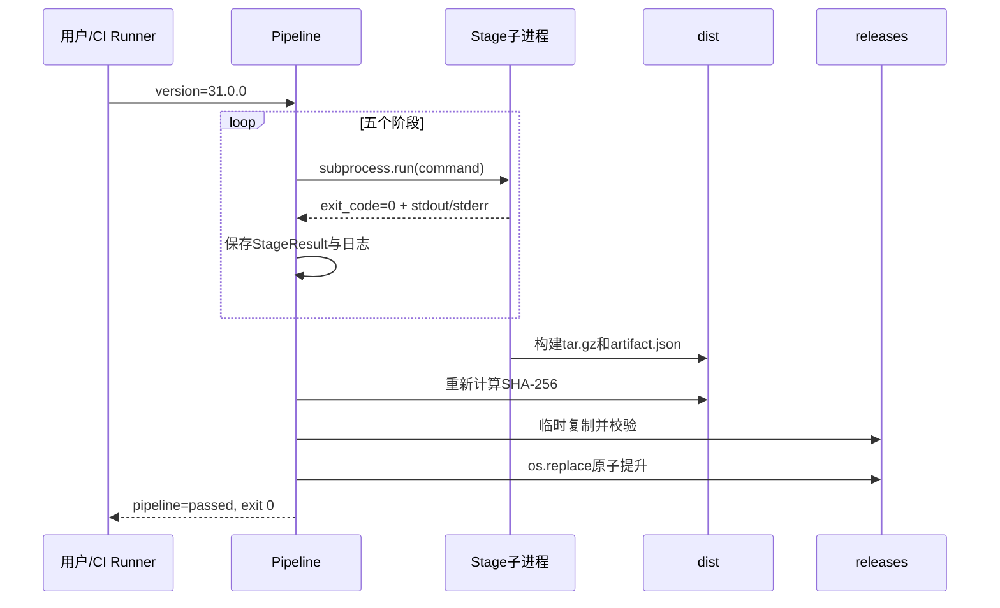
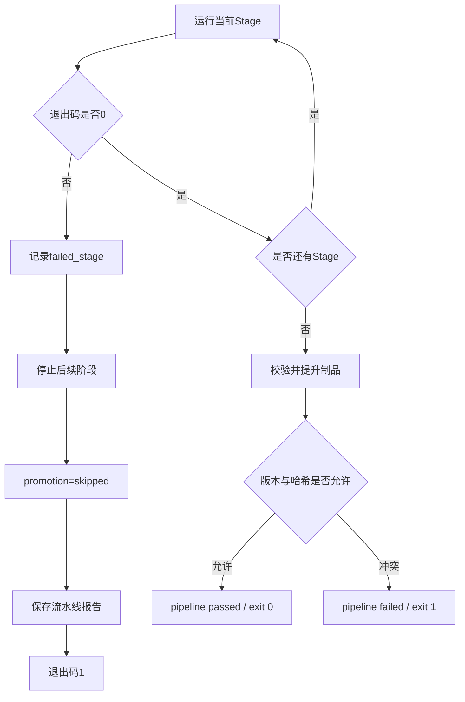

# Day31 最终代码详细解读

本文重点解读最终编排文件：

`day31/python/day31_ci_cd_pipeline.py`

并说明它如何调用 Day31 前五步形成一条完整发布流水线。

---

## 一、代码职责

最终流水线本身不重新实现测试与构建逻辑，而是负责：

1. 定义阶段及顺序；
2. 为每次运行生成唯一编号；
3. 在独立子进程执行每个阶段；
4. 捕获退出码、输出、耗时与异常；
5. fail-fast；
6. 校验构建制品；
7. 执行不可变版本检查；
8. 原子提升制品；
9. 保存阶段日志与汇总报告；
10. 返回 CI 最终退出码。

它属于 orchestration layer，也就是编排层。

---

## 二、目录常量

### `PROJECT_ROOT`

项目根目录，所有子进程都以它作为 `cwd`。这样各脚本中的相对路径行为保持一致。

### `PYTHON_DIR`

Day31脚本目录，用来拼接每个阶段的程序路径。

### `DIST_DIR`

构建产物暂存区：

```text
day31/dist/
```

这里的文件已经构建和校验，但尚未表示“正式提升”。

### `RELEASES_DIR`

发布提升区：

```text
day31/releases/<version>/
```

只有全阶段通过的制品才能进入这里。

### `LOG_ROOT`

每次流水线运行的独立日志根目录。

### `LATEST_REPORT_PATH`

保存最新一次流水线汇总，方便外部工具不需要先寻找最新 `run_id`。

---

## 三、三个核心数据模型

### `StageDefinition`

```python
name: str
description: str
command: tuple[str, ...]
```

它表示“计划执行什么”，属于静态配置。

为什么 `command` 使用元组而不是字符串：

- `subprocess.run()` 可以直接接收参数列表；
- 不需要 Shell 解析；
- 避免引号和空格问题；
- 降低 Shell 注入风险。

### `StageResult`

```python
name: str
description: str
status: str
exit_code: int | None
duration_seconds: float
command: list[str]
log_path: str
error: str | None
```

它表示“实际发生了什么”。

`exit_code=None` 表示子进程没有正常产生退出码，例如启动失败或超时终止。

### `PromotionResult`

记录发布提升是否执行、版本、目录、制品、哈希和详细原因。

分离 Stage 与 Promotion 的原因是：

- 测试阶段证明质量；
- Promotion改变制品所处发布状态；
- 两者失败含义不同。

---

## 四、`validate_version()`

接受：

```text
31.0.0
31.0.1
31.0.0-rc1
```

拒绝包含空格、斜杠和特殊路径字符的版本。这不仅是格式要求，也防止版本字符串被利用来构造危险文件路径。

---

## 五、`build_stages(version)`

返回 `list[StageDefinition]`，顺序如下：

### 1. `quality_gate`

执行编译、配置、迁移、健康和Preflight。

这是最便宜、最基础的检查。基础环境已经错误时，不值得继续启动HTTP集成测试。

### 2. `api_contracts`

验证HTTP外部行为。

### 3. `fake_integration`

验证真实RAG控制流和组件协作。

### 4. `load_slo`

验证并发与性能基线。它比单请求测试更耗时，所以放在功能正确性之后。

### 5. `build_artifact`

只有前面都通过后才构建发布包，避免为坏版本产生正式制品。

`version` 会作为两个独立命令参数传递：

```python
"--version", version
```

不经过 Shell 字符串拼接。

---

## 六、`ci_environment()`

复制当前系统环境，并加入：

```text
CI=true
PYTHONUNBUFFERED=1
DAY31_CI_RUN_ID=<run_id>
DAY31_RELEASE_VERSION=<version>
```

### `PYTHONUNBUFFERED=1`

关闭Python标准输出缓冲。长时间运行的CI阶段能更及时产生日志，而不是进程结束才一次性写出。

### 为什么继承环境

当前练习的 `.env` 和 Python 环境仍然需要使用。但流水线不会把整个环境写入日志，以免泄露密钥。

---

## 七、`write_stage_log()`

每个阶段独立保存：

```text
阶段名
说明
命令
stdout
stderr
```

终端只显示摘要，详细输出进入日志。这样既保持流水线输出清晰，又保留排错证据。

注意：生产系统还应在日志写入前做统一敏感字段清洗。本课程各阶段已经避免打印真实密钥。

---

## 八、`run_stage()`

这是阶段执行核心。

### 参数

```python
definition: StageDefinition
run_directory: Path
environment: dict[str, str]
```

### 返回值

```python
StageResult
```

### 正常执行

```python
subprocess.run(
    definition.command,
    cwd=PROJECT_ROOT,
    env=environment,
    text=True,
    capture_output=True,
    timeout=180,
    check=False,
)
```

关键参数：

- `text=True`：stdout/stderr直接返回字符串；
- `capture_output=True`：捕获两路输出；
- `timeout`：防止阶段无限挂起；
- `check=False`：不自动抛 `CalledProcessError`，由流水线统一解释退出码。

### 超时路径

捕获 `TimeoutExpired`，保留超时前已有输出，阶段状态记为失败，`exit_code=None`。

### 启动失败路径

例如Python可执行文件不存在时捕获 `OSError`，写入阶段日志并返回失败结果。

无论哪种路径，调用者始终得到统一 `StageResult`，无需处理多种异常类型。

---

## 九、SHA-256校验

`sha256_file()` 分块读取文件：

```python
while block := file.read(1024 * 1024):
```

即使制品很大，也不会一次性全部装进内存。

SHA-256在这里用于：

- 校验 `dist` 制品与外部manifest一致；
- 校验复制前后内容一致；
- 判断相同版本是否真的是同一制品。

---

## 十、`copy_file_atomically()`

数据流：

```text
源制品
→ 发布目录同级临时文件
→ 复制
→ 对比源与临时文件SHA-256
→ os.replace(temp, target)
```

为什么临时文件必须位于目标目录：

`os.replace()` 在同一文件系统中通常能原子完成，消费者不会看到半份目标文件。

发生异常时删除临时文件，不影响原有目标。

---

## 十一、`promote_release(version)`

### 第一步：检查构建输出

必须同时存在：

```text
rag-service-<version>.tar.gz
rag-service-<version>.artifact.json
```

### 第二步：验证外部manifest

重新计算制品SHA-256，并与 `artifact.json` 对比。不信任“文件名看起来正确”。

### 第三步：版本不可变判断

目标制品不存在：

```text
原子复制制品
→ 原子复制manifest
→ promoted
```

目标存在且哈希相同：

```text
幂等跳过
→ promoted
```

目标存在但哈希不同：

```text
拒绝覆盖
→ failed
```

这保证一个版本号不会指向两套不同字节。

---

## 十二、`write_json_atomically()`

汇总报告也采用：

```text
mkstemp
→ json.dump
→ flush
→ fsync
→ os.replace
```

`flush()` 把Python缓冲写给操作系统，`fsync()`要求操作系统把内容同步到底层存储，然后才原子改名。

---

## 十三、`main()`完整流程

### 1. 解析版本

默认 `31.0.0`，可以通过命令行覆盖。

### 2. 创建run_id

```text
UTC时间-8位随机值
```

时间便于排序，随机值避免同一秒运行冲突。

### 3. 创建独立日志目录

使用 `exist_ok=False`，理论上发生ID冲突时立即失败，而不是混合两次运行日志。

### 4. 顺序执行阶段

每次得到 `StageResult` 后立即显示摘要并加入结果列表。

### 5. fail-fast

```python
if result.status != "passed":
    failed_stage = result.name
    break
```

### 6. Promotion

只有 `failed_stage is None` 才调用 `promote_release()`；否则明确构造 `skipped` 结果。

### 7. 最终判定

通过需要同时满足：

```text
实际执行阶段数 == 预期阶段数
所有StageResult.status == passed
PromotionResult.status == promoted
```

缺一不可。

### 8. 保存两份报告

```text
本次run目录/pipeline-report.json
day31/logs/day31_ci_pipeline_report.json
```

### 9. 进程退出码

```python
0 if pipeline_passed else 1
```

这让更外层的 GitHub Actions、GitLab CI、Jenkins 或 Shell 可以继续使用同一判定。

---

## 十四、完整成功数据流



---

## 十五、完整失败数据流



---

## 十六、前五个脚本在流水线中的职责

| 脚本 | 主要输入 | 主要输出 | 失败含义 |
|---|---|---|---|
| `day31_quality_gate.py` | Day30代码与运行环境 | 质量报告、退出码 | 基础环境或生产化检查失败 |
| `day31_api_contract_tests.py` | HTTP应用 + Fake流水线 | unittest结果 | 外部API行为被破坏 |
| `day31_fake_integration_tests.py` | Fake边界 + 真实控制流 | 三条业务路径结果 | RAG组件协作错误 |
| `day31_load_slo_test.py` | 并发参数 + Fake延迟 | SLO报告 | 性能或并发保护不达标 |
| `day31_release_artifact.py` | 白名单源码 + 版本 | tar.gz和manifest | 制品不安全或不可验证 |

---

## 十七、重要数据类型汇总

| 名称 | 类型 | 含义 |
|---|---|---|
| `stages` | `list[StageDefinition]` | 计划执行的阶段 |
| `results` | `list[StageResult]` | 已经执行的阶段结果 |
| `failed_stage` | `str | None` | 首个失败阶段 |
| `environment` | `dict[str, str]` | 传给子进程的环境副本 |
| `run_directory` | `Path` | 当前运行的独立日志目录 |
| `promotion` | `PromotionResult` | 制品提升结果 |
| `pipeline_passed` | `bool` | 最终发布结论 |
| `report` | `dict[str, object]` | 可序列化流水线报告 |

---

## 十八、为什么不直接部署外部服务器

本步骤完成的是本地持续交付闭环：

```text
检查 → 测试 → 构建 → 校验 → 提升不可变制品
```

真正生产部署还需要用户明确提供和授权：

- 云平台或服务器；
- 镜像仓库或制品仓库；
- 网络与域名；
- 密钥管理；
- 部署账号权限；
- 灰度和回滚策略；
- 人工审批要求。

自动化不等于擅自扩大操作范围。没有这些明确上下文时，正确终点是产出经过验证、可交付的不可变制品。

---

## 十九、后续可增强方向

- 将阶段定义写入 GitHub Actions 或 GitLab CI；
- 并行执行互不依赖的契约测试与集成测试；
- 上传制品到对象存储或制品仓库；
- 生成 SBOM；
- 对制品进行数字签名和签名验证；
- 增加依赖漏洞扫描；
- 增加容器镜像构建与镜像扫描；
- 增加 staging 部署和 smoke test；
- 增加人工审批后的生产提升；
- 增加蓝绿、金丝雀发布与自动回滚。

---

## 二十、最终心智模型

```text
源代码本身不能证明可以发布
        ↓
基础门禁证明环境与结构正确
        ↓
契约测试证明客户端依赖没有破坏
        ↓
集成测试证明组件能够协作
        ↓
SLO证明当前基线满足性能目标
        ↓
可重复构建把源码变成唯一制品
        ↓
哈希与manifest证明制品完整
        ↓
版本不可变策略防止历史被覆盖
        ↓
原子提升让发布区只出现完整制品
        ↓
日志与报告让整个过程可审计
```

Day31的核心不是“写一个很长的CI脚本”，而是：

> 把原来依靠人记忆和手工执行的发布判断，变成可重复、可阻断、可审计的机器流程。

