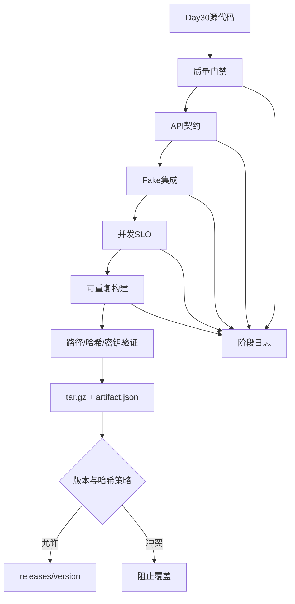

# LangChain 学习 Day31：持续集成、质量门禁与自动化发布

## 今日目标

Day30 已经把 RAG 程序整理成可配置、可迁移、可检查、可备份的生产化服务。Day31 继续解决另一个问题：

> 如何让机器自动证明一个版本满足发布要求，并且只发布经过验证的不可变制品？

今天固定完成 7 步：

1. 自动化质量门禁
2. HTTP API 契约测试
3. Fake 端到端集成测试
4. 并发压测与 SLO 判定
5. 发布制品与校验清单
6. 完整 CI/CD 发布流水线
7. 总结笔记与最终代码详细解读

---

## 第1步：自动化质量门禁

文件：`day31/python/day31_quality_gate.py`

### 质量门禁是什么

质量门禁不是一项具体测试，而是一组必须通过的检查。它把多个脚本统一成一个最终结论：

```text
全部通过 → exit code 0 → 可以继续
任一失败 → exit code 1 → 阻止发布
```

本步包含5项：

1. 编译 Day30 全部 Python 文件；
2. 配置、类型和密钥检查；
3. 数据库迁移、checksum、幂等和回滚；
4. 健康与就绪检查；
5. 发布前 Preflight。

### 为什么用 subprocess

每项检查在独立进程中运行：

- 全局变量互不污染；
- 某个脚本的 `SystemExit` 不会杀死主程序；
- 可以单独设置超时；
- 可以捕获 stdout、stderr 和退出码；
- 更接近真实 CI Runner 的执行方式。

### 机器可读报告

除了终端输出，还生成 JSON，包含：

- 实际命令；
- 退出码；
- 耗时；
- stdout；
- stderr；
- 错误原因；
- 总体通过/失败。

报告使用临时文件加 `os.replace()` 原子发布，避免程序中途退出留下半份 JSON。

---

## 第2步：HTTP API 契约测试

文件：`day31/python/day31_api_contract_tests.py`

### 什么是 API 契约

契约是客户端与服务端共同依赖的外部行为：

- 路由；
- HTTP方法；
- 请求格式；
- 状态码；
- JSON字段名；
- 字段类型；
- 错误行为。

内部代码可以重构，但契约不应无意改变。

### 本步验证的10项契约

```text
GET  /
GET  /livez
GET  /readyz
POST /ask 成功响应
GET  /requests/{request_id}
GET  /ops/status
非法JSON → 400
额外字段 → 400
空白问题 → 400
不存在请求 → 404
```

### 测试隔离

```text
临时SQLite数据库
→ 执行v1到v3迁移
→ aiohttp临时服务器
→ 真实HTTP请求
→ AsyncMock替换整个RAG流水线
→ 测试结束自动删除数据库
```

此时真实执行的是 HTTP、中间件、参数校验和数据库接口，不执行模型网络调用。

---

## 第3步：Fake端到端集成测试

文件：`day31/python/day31_fake_integration_tests.py`

### 与契约测试的区别

契约测试：

```text
execute_rag_pipeline整体替换
重点验证HTTP边界
```

集成测试：

```text
execute_rag_pipeline真实执行
只替换检索输入、Reranker输出和模型网络调用
```

因此集成测试覆盖更多内部协作关系：

- RRF候选如何传给 Reranker；
- 相关性分数如何经过95分阈值；
- 证据如何进入 Prompt；
- `[资料1]` 如何出现；
- Token如何读取；
- 回答与来源如何事务写入；
- 模型异常如何转成安全500并持久化 `failed`。

### 三条业务路径

```text
高相关99分
→ 通过守门
→ Fake LLM
→ success + sources

低相关40分
→ 守门拒绝
→ 不调用回答模型
→ Token为0

模型抛出异常
→ failed记录
→ HTTP 500
→ 不向客户端泄露内部异常
```

### Fake不是随便返回字符串

Fake组件应当模仿真实接口：

- `ainvoke(messages)` 是异步方法；
- 返回 `AIMessage`；
- 携带 `usage_metadata`；
- 记录调用次数与收到的 Prompt；
- 能切换为确定性异常。

Fake越符合真实接口，测试越有价值。

---

## 第4步：并发压测与SLO

文件：`day31/python/day31_load_slo_test.py`

### 两层Semaphore

```text
客户端Semaphore
→ 控制同时发出的HTTP请求数量

服务端Semaphore
→ 控制同时进入昂贵RAG流水线的请求数量
```

大量连接可以进入服务器，但有限模型资源受到服务端并发限制保护。

### 指标

本步测量：

- 成功数与失败数；
- 成功率；
- 总墙钟耗时；
- 每秒请求数 RPS；
- 最小、平均、P50、P95、P99、最大延迟；
- 服务端最大活动流水线数；
- SQLite最终持久化记录数。

### 百分位数

平均值容易掩盖少量慢请求。P95表示：

> 95%的请求延迟不超过该值，最慢5%可能更慢。

面向用户体验时，P95/P99通常比平均值更重要。

### 本地Fake SLO

```text
成功率 >= 99%
P95 <= 2秒
吞吐量 >= 10 RPS
最大活动流水线 <= 配置并发
持久化记录数 == 预期数量
```

这些目标只适合当前固定延迟Fake基线。真实模型的生产SLO要结合供应商延迟、费用、限流和实际业务流量重新测量。

---

## 第5步：发布制品

文件：`day31/python/day31_release_artifact.py`

### 白名单打包

程序明确列出允许进入制品的文件，而不是把项目全部打包后再排除。

白名单更安全，因为新增的数据库、日志或私密文件默认不会被带入制品。

### 明确排除

```text
.env和真实密钥
运行数据库、WAL和SHM
数据库备份和日志
用户上传
现有向量及FTS索引
.venv、__pycache__和模型缓存
```

这体现了：

> 不可变代码制品与可变运行数据必须分离。

### 两层清单

内部 `MANIFEST.json`：

- 每个文件的归档路径；
- 大小；
- SHA-256；
- 来源。

外部 `artifact.json`：

- 制品版本；
- tar.gz文件名；
- 整体大小；
- 整体SHA-256；
- 排除项；
- 验证结论。

### 可重复构建

为了让同一源码产生相同字节：

- 文件按路径排序；
- tar `mtime=0`；
- gzip `mtime=0`；
- uid/gid固定为0；
- 用户名和组名固定；
- 文件权限固定；
- 内部manifest不写当前时间。

连续构建两次得到同一个 SHA-256，说明可重复构建成立。

### 供应链安全检查

重新打开归档并检查：

- 是否存在绝对路径；
- 是否出现 `..` 路径穿越；
- 是否包含软链接或硬链接；
- 文件数量是否一致；
- 文件大小与哈希是否一致；
- 本机真实密钥是否进入任何文件。

---

## 第6步：完整CI/CD流水线

文件：`day31/python/day31_ci_cd_pipeline.py`

### 阶段顺序


顺序表达依赖关系：只有更便宜、更基础的检查通过，才运行后续更完整的检查；只有所有测试通过，才允许构建和提升制品。

### fail-fast

```text
当前阶段失败
→ 保存阶段日志
→ 停止后续阶段
→ promotion=skipped
→ pipeline=failed
→ 退出码1
```

fail-fast既节省资源，也避免在已知错误版本上继续生成“看起来可发布”的制品。

### 不可变版本

```text
版本不存在
→ 原子发布

版本存在且哈希相同
→ 幂等成功

版本存在但哈希不同
→ 拒绝覆盖
→ 必须使用新版本号
```

同一个版本必须永远代表同一个制品。

### 原子提升

```text
复制到发布目录的临时文件
→ 对比源文件与临时文件SHA-256
→ os.replace原子改名
```

这样消费者不会读到复制了一半的制品。

### 每次运行独立记录

每次流水线拥有 `run_id`，对应独立日志目录：

```text
quality_gate.log
api_contracts.log
fake_integration.log
load_slo.log
build_artifact.log
pipeline-report.json
```

同时维护 `day31_ci_pipeline_report.json` 指向最新一次结果，兼顾历史审计和快速查看。

---

## 测试金字塔在本项目中的对应关系

```text
                 少、慢、完整
              ┌──────────────┐
              │ 本地CI/CD全链 │
            ┌─┴──────────────┴─┐
            │ 并发压测与SLO      │
          ┌─┴──────────────────┴─┐
          │ Fake端到端集成测试     │
        ┌─┴──────────────────────┴─┐
        │ HTTP API契约测试           │
      ┌─┴──────────────────────────┴─┐
      │ 编译、配置、迁移、健康等门禁   │
      └──────────────────────────────┘
                 多、快、基础
```

不同层解决不同问题，不能只依赖一种测试。

---

## CI与CD的区别

### CI：持续集成

负责证明代码变化没有破坏系统：

- 编译；
- 静态与配置检查；
- 单元、契约和集成测试；
- 性能基线；
- 构建制品。

### CD：持续交付/部署

负责把已经验证的制品向后推进：

- 提升到发布区；
- 部署测试环境；
- 人工审批或自动策略；
- 灰度发布；
- 生产发布；
- 回滚。

本地练习实现到“经过全套检查后提升不可变制品”，没有擅自部署到外部服务器。

---

## Day31总体数据流



---

## 今日必须掌握的结论

1. 自动化检查必须用退出码给出明确结论。
2. API契约测试保护的是外部行为，不是内部实现。
3. Fake集成测试应保留真实控制流，只替换不稳定或昂贵边界。
4. P95/P99比只看平均延迟更能反映尾部用户体验。
5. SLO必须自动判断，不能只打印一堆数字。
6. 发布包必须使用白名单，并主动扫描真实密钥泄露。
7. 代码制品与数据库、上传、日志等运行数据必须分离。
8. 可重复构建让同一源码对应唯一制品哈希。
9. fail-fast阻止错误版本继续消耗资源或进入发布区。
10. 同版本不同哈希必须拒绝覆盖。

---

## 复习命令

```bash
# 第1步：质量门禁
python day31/python/day31_quality_gate.py

# 第2步：API契约测试
python day31/python/day31_api_contract_tests.py

# 第3步：Fake端到端集成测试
python day31/python/day31_fake_integration_tests.py

# 第4步：并发压测与SLO
python day31/python/day31_load_slo_test.py

# 第5步：构建制品
python day31/python/day31_release_artifact.py --version 31.0.0

# 第6步：运行完整CI/CD
python day31/python/day31_ci_cd_pipeline.py --version 31.0.0
```

## Day31完成标准

- 能解释契约测试和集成测试的区别；
- 能说明为何用 subprocess 运行门禁；
- 能解释客户端与服务端两层Semaphore；
- 能计算并解释P95；
- 能说明为什么构建包不能包含 `.env` 和运行数据库；
- 能解释可重复构建需要固定哪些元数据；
- 能说明 fail-fast 和版本不可变策略；
- 能沿完整流水线解释一个版本如何进入 `releases`。

