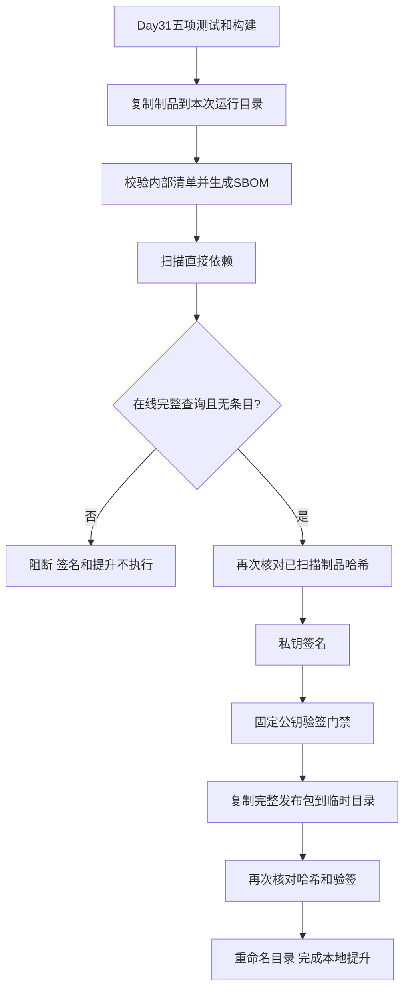

# Day32：软件供应链安全与制品签名

今天完成固定7步：SBOM、风险扫描、HMAC、Ed25519、强制验签、接入流水线、复习解读。

## 1. 软件物料清单 SBOM

代码：`day32/python/day32_sbom_basic.py`。

发布包就像一件组装产品。SBOM记录产品名称、版本、组成文件与依赖，帮助后续追踪和扫描。

当前输入是Day31已发布的tar.gz。程序不解压文件到工作目录，而是在归档中读取数据，检查路径、文件类型、体积上限和内部MANIFEST。

然后从包内requirements.lock.txt读取依赖名称与精确版本。读取制品自身的依赖声明，比读取当前开发机pip环境更能描述这个制品。

输出包含：

- 应用名称和版本；
- 整个制品的SHA-256；
- 24个清单文件的大小和哈希；
- 10项声明的直接依赖；
- 清单覆盖范围和限制。

当前是课程自定义JSON，未宣称符合CycloneDX/SPDX，也没有解析完整传递依赖或许可证。文件名叫lock也不意味着完整依赖树已被锁定。

## 2. 已知风险扫描

代码：`day32/python/day32_dependency_scan.py`。

输入SBOM，逐包使用名称、生态和精确版本进行判断。

| 状态 | 含义 | 门禁行为 |
|---|---|---|
| findings | 发现风险条目 | 阻止 |
| no_known_findings | 当前查询范围内未找到记录 | 本项可通过 |
| unknown | 查询未完成或没有覆盖 | 阻止 |

demo模式使用虚构规则，其中DEMO-ONLY-001不是实际漏洞编号，不能据此推断aiohttp存在真实漏洞。

online模式查询OSV的querybatch接口。响应顺序对应输入顺序；有next_page_token时继续请求该包的下一页。网络失败或分页未完成不能判为安全。

退出码：0=查询完成且无条目；1=有条目且没有未知；2=存在未知。部分分页已经发现的条目在后续网络失败时仍然保留。

官方接口说明：https://google.github.io/osv.dev/post-v1-querybatch/

## 3. SHA-256、HMAC、Ed25519

| 机制 | 需要秘密吗 | 能证明什么 | 验证者能否生成认证结果 |
|---|---|---|---|
| SHA-256 | 不需要 | 与可信参考哈希比较时发现内容变化 | 任何人都能重新计算 |
| HMAC-SHA256 | 共享密钥 | 共享密钥持有者认证了数据 | 能，因为持有同一密钥 |
| Ed25519 | 签名用私钥，验签用公钥 | 对应私钥签署了声明 | 仅持公钥不能签名 |

这三者都不会加密制品正文，也不会证明代码不存在漏洞。

### HMAC

代码：`day32/python/day32_hmac_artifact.py`。

共享密钥 + 固定前缀 + 规范化元数据 + 完整文件字节 → HMAC认证码。

认证码保存为JSON，比较时使用hmac.compare_digest。密钥使用32字节随机数，权限600，位于被Git忽略的private目录。

### Ed25519

代码：`day32/python/day32_ed25519_artifact.py`。

先计算制品SHA-256，再把文件名、大小、哈希、算法和公钥指纹组成声明，用私钥签署规范化声明。

验证时：公钥验证声明签名，再核对实际文件的名称、大小和哈希。

JSON字段顺序可以变化，所以双方采用sort_keys和固定分隔符编码；域前缀用于区分本课程协议的签名用途。

签名是字节，JSON不能直接表示任意字节，因此采用Base64编码。Base64不是加密。

## 4. 公钥信任与强制门禁

代码：`day32/python/day32_signature_gate.py`。

仅仅“签名能被随附公钥验证”不够。如果攻击者替换制品、签名和公钥，也可以生成一套数学上成立的签名。

因此本地配置release_trust.json预先固定可信公钥的SHA-256指纹，且不从收到的签名自动生成。

```text
独立信任策略
→ 公钥指纹匹配
→ 声明签名有效
→ 制品哈希一致
→ 内部文件清单有效
→ allow
```

第一项失败即停止，后续检查标记skipped。报告和退出码允许外层流水线强制执行这一规则。

信任策略本身必须受到保护。能任意修改策略、流水线代码和私钥的人，也能改变发布判断。

## 5. 供应链流水线

代码：`day32/python/day32_supply_chain_pipeline.py`。



本次实际测试走默认demo路径：前五个基础阶段通过，SBOM成功，扫描拒绝，签名和提升未执行，退出码1。这个结果证明阻断有效，不表示在线放行流程已被完整验证。

正式放行条件是online模式、无unknown、无风险条目，随后签名和验签也必须通过。当前只是直接依赖范围的门禁。

## 6. 重要边界

- 签名证明认可某些字节，不证明软件无漏洞。
- 查询无条目不等于所有风险都已排除。
- SBOM和扫描报告目前随制品分发，但并未单独签名；制品签名只覆盖制品声明。
- 公钥指纹策略需要独立可信配置管理。
- 私钥目前是权限600的未加密本机PEM；真实发布可使用密钥管理服务或硬件签名设备。
- 当前没有部署到外部服务器，也没有自动修改已有不可变发布。

## 7. 复习命令

```bash
python day32/python/day32_sbom_basic.py
python day32/python/day32_dependency_scan.py
python day32/python/day32_dependency_scan.py --mode online
python day32/python/day32_hmac_artifact.py
python day32/python/day32_hmac_artifact.py --action verify
python day32/python/day32_ed25519_artifact.py
python day32/python/day32_ed25519_artifact.py --action verify
python day32/python/day32_signature_gate.py
python day32/python/day32_supply_chain_pipeline.py
```

demo扫描和默认流水线返回非零退出码是预期教学结果。单独verify不会重新签名；默认签名演示会签署当前输入文件，因此检查篡改时应使用verify。

## 自测问题

1. 为什么SBOM要从发布包读取依赖？
2. unknown为什么不能变成通过？
3. 为什么HMAC验证方也能签名？
4. Ed25519验证需要读取私钥吗？
5. 为什么不能无条件信任签名附带的公钥？
6. 如何确保扫描和签名针对同一制品？
7. 为什么签名通过后仍要检查依赖风险？
8. 本次流水线为什么显示failed却是正确结果？
