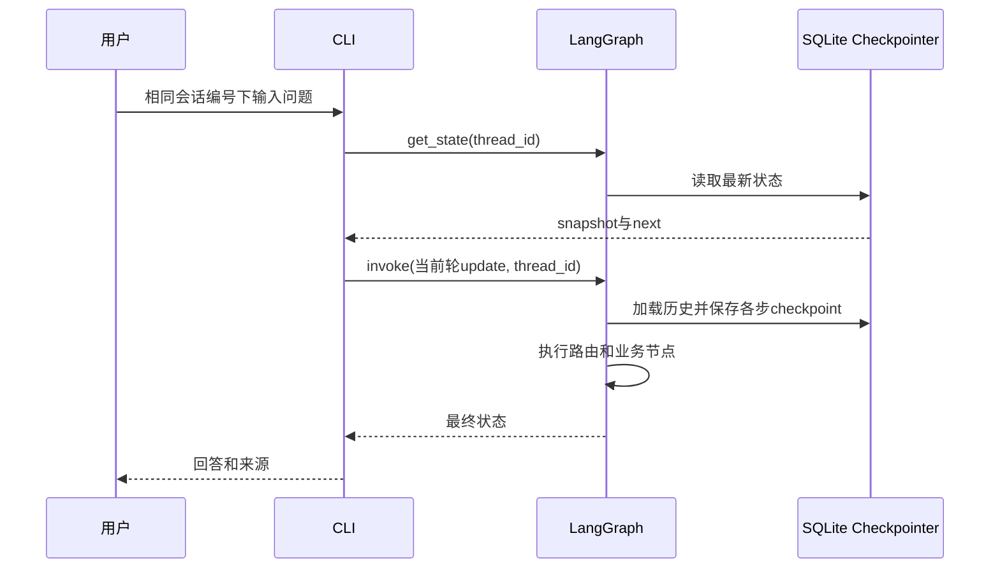

# Day33 最终代码详细解读

最终入口：day33/python/day33_learning_assistant.py。

核心业务图：day33/python/day33_persistent_agent.py。

完整程序由同目录各模块组成。新的完整入口可以直接运行，但不是脱离依赖模块的单文件程序。

## 一、代码调用关系

```text
learning_assistant.main
→ SqliteSaver打开数据库
→ persistent_agent.build_graph
   → knowledge_agent.create_models
   → 注册聊天、计算、检索、回答、资料不足、笔记占位节点
   → ToolNode注册工具
   → compile(checkpointer=saver)
→ chat_loop
   → 本地命令 / 普通用户输入
   → persistent_agent.run_turn
      → UserRequest
      → graph.invoke(update, config_for(session_id))
```

## 二、main：启动与资源生命周期

三个启动参数：session_id、--demo、--check。

--demo与--check互斥。demo是可交互的固定样例模式；check自动输入一组命令做接线验收。

正常数据库为day33/database/day33_agent.db，demo为day33_agent_demo.db；check用临时目录，完成后自动清理。

```python
with SqliteSaver.from_conn_string(str(database)) as saver:
    graph = build_graph(saver, demo=args.demo)
    _, success = chat_loop(graph, session_id)
```

上下文退出后关闭SQLite连接。输入循环运行期间，模型与图重复使用。

退出码0表示正常结束，1表示本轮失败后停止。程序结束不会删除业务数据库。

## 三、validated_session_id

参数value为str，返回经过验证和去除首尾空白的会话编号。

内部复用UserRequest构造，并传入固定非空question满足模型要求。

会话编号只作为thread_id，不拼接成文件路径。切换session_id是切换同一SQLite里的状态命名空间。

## 四、chat_loop

参数：graph是已编译图；session_id是str；read_input是Callable[[str], str]，默认Python input。

返回tuple[str, bool]：最后使用的会话编号、是否正常结束。

read_input可以注入脚本函数，因此自动检查与真人使用同一套命令分发逻辑。

每轮执行：

1. 读取并strip输入。
2. 空白提示后继续。
3. exit退出；EOF与Ctrl+C在输入阶段也正常退出。
4. 命令在本地分发，不送入图。
5. Pydantic校验普通问题。
6. get_state检查待执行节点。
7. run_turn执行一轮。
8. 普通异常或执行阶段Ctrl+C结束程序，保留已有checkpoint。

此处没有承诺自动恢复失败任务。如果状态中还有next节点，下一次启动会显示并阻止新问题；可以切换新会话继续其他工作。

## 五、show_status与show_history

```python
snapshot = graph.get_state(config_for(session_id))
```

snapshot.values包含共享状态；snapshot.next是待执行节点名称元组。

show_status只读取消息数量、最后route与next。show_history取最后12条消息，分别显示HumanMessage、AIMessage和ToolMessage。

AIMessage带tool_calls时打印工具参数；ToolMessage打印tool_call_id。这样可以检查一次计算为何产生6条消息。

读取状态不调用LLM，也不增加历史消息。

## 六、config_for

```python
{
    "configurable": {"thread_id": session_id},
    "recursion_limit": 20
}
```

thread_id交给checkpointer定位会话；recursion_limit限制图执行步数，不能当作HTTP超时或总耗时上限。

## 七、run_turn与状态更新

run_turn先把输入封装成UserRequest，然后构造update：

| 字段 | 本轮传入 | 更新方式 |
|---|---|---|
| session_id | 当前会话编号 | 覆盖 |
| question | 当前问题 | 覆盖 |
| messages | 仅一条新HumanMessage | add_messages合并 |
| route | None | 清除上轮路由 |
| evidence | [] | 清除上轮资料 |
| answer | 空字符串 | 清除上轮回答 |
| pending_note | None | 当前尚未实现审批 |
| approval | None | 当前尚未实现审批 |

重置evidence不会删除SQLite过去的checkpoint，但新一轮状态不再把旧资料误当成当前检索结果。

graph.invoke返回最终状态dict，run_turn打印回答、来源、路线和累计消息数。

## 八、模型对象如何创建

正常模式create_models创建一个普通ChatOpenAI对象llm，同时返回llm.bind_tools(TOOLS)和llm。

calculator_model是绑定工具的Runnable，answer_model是普通llm。chat_model复用answer_model。因此这些角色共享同一模型配置，不意味着三个独立远程模型。

知识路线里的Day22 Reranker另行创建结构化模型调用。一个RAG问题通常包含精排和生成两类LLM请求。

本地Embedding不是聊天LLM。router使用关键词规则，条件边和引用编号检查也不调用LLM。

Fake模式分别使用固定聊天、计算和知识回答对象。计算Fake只检查当前轮消息，避免历史工具结果干扰固定演示步骤。

## 九、路由节点

router_node判断question并返回Route枚举。持久化版本的route_node把枚举转成普通字符串后保存。

route_edge只读取字符串决定下一节点：

```text
chat → chat
calculate → calculator
knowledge → retrieve
save_note → note
```

例如“把RAG的定义保存为学习笔记”同时含知识关键词，但保存笔记规则在前，进入note。

“刚才的结果是多少”进入chat，chat模型能读取历史工具消息。当前“那它是什么”等知识追问不会自动改写成独立检索问题。

## 十、聊天节点收到什么

```text
临时SystemMessage
+ state.messages里的全部历史
→ chat_model.invoke
→ response_update
```

response_update把回答文本写answer，并新建一条AIMessage加入messages。

临时SystemMessage没有通过状态增量返回，所以不会写入messages历史。

## 十一、计算节点与工具循环

calculator收到临时系统消息与整个历史。响应有tool_calls时只追加AIMessage，没有tool_calls时还写入answer。

tools_condition读取最后消息；有工具请求进入ToolNode，否则END。

ToolNode按name找到add/multiply，对args执行校验和函数调用，生成带对应tool_call_id的ToolMessage；tools边再回calculator。

```text
1 HumanMessage：请计算(20+4)*3
2 AIMessage：请求add(20,4)
3 ToolMessage：24
4 AIMessage：请求multiply(24,3)
5 ToolMessage：72
6 AIMessage：最终答案
```

这6条都会进入messages和checkpoint。工具不是模型在远端自动执行的，实际函数执行发生在本机ToolNode。

## 十二、检索与回答节点

retrieve_course_evidence延迟导入Day22模块。只有进入知识分支才加载相关Embedding与检索模块。

混合检索返回候选，精排返回相关性分数，保留达到95分的前3条，封装为Evidence。

持久化节点把Evidence.model_dump()转换成普通字典列表写evidence。

证据为空转insufficient，直接回复资料不足；证据非空转answer。

answer只发送两条临时消息：系统规则，以及包含当前question和context的HumanMessage。它没有发送state.messages整个历史。

回答生成后用正则提取[资料N]，检查至少一个编号存在、且所有编号在证据范围内。它不检查每个结论是否被证据语义支持。

如果模型诚实说明资料不足但没有引用，也会被当前通用编号检查替换为检查失败提示。这是当前实现的边界，毕业验收时应覆盖该情况。

## 十三、哪些内容写进消息历史

| 数据或返回结果 | 写入messages吗 |
|---|---|
| 用户普通问题 | 是，HumanMessage |
| 聊天最终回复 | 是，AIMessage |
| 计算模型工具请求 | 是，带tool_calls的AIMessage |
| 工具执行结果 | 是，ToolMessage |
| 计算最终回复 | 是，AIMessage |
| 通过引用检查的知识回答 | 是，AIMessage文本 |
| 引用失败或资料不足提示 | 是，AIMessage |
| 笔记占位说明 | 是，AIMessage |
| router路线 | 否，写route字段 |
| 精排结构化结果 | 否，用于选择证据 |
| evidence正文 | 否，单独状态字段中保存 |
| 临时系统提示词与知识Prompt | 否，未作为增量返回 |
| /help等本地命令 | 否，在CLI中处理 |

注意“未写messages”和“未持久化”不同：evidence作为状态字段仍可被SqliteSaver保存。

## 十四、SQLite恢复顺序



重启后重建图不等于清空历史；只要数据库路径和thread_id相同，就可以恢复对应已保存状态。

## 十五、check_interaction自动验证

构造临时SQLite和一组脚本输入：空白、帮助、姓名、计算、检索、历史、状态、切换会话、笔记占位、退出。

随后关闭连接、重新编译图，再从同一数据库同一会话问名字。

这些检查证明交互命令、消息合并、工具执行和checkpoint接线正确。Fake回答固定，不能证明DeepSeek实际理解能力或真实向量索引检索质量。

## 十六、明天继续的位置

note_node目前只是占位回复，不写文件，也没有调用interrupt。

Day34将围绕pending_note和approval构建真正的暂停、人工决定和受控写入，并补充失败场景验证。日常聊天入口也需要区分“普通新问题”和“恢复审批决定”，不能简单把yes当成新消息重新路由。

今天7步到此完成，不再追加功能。
