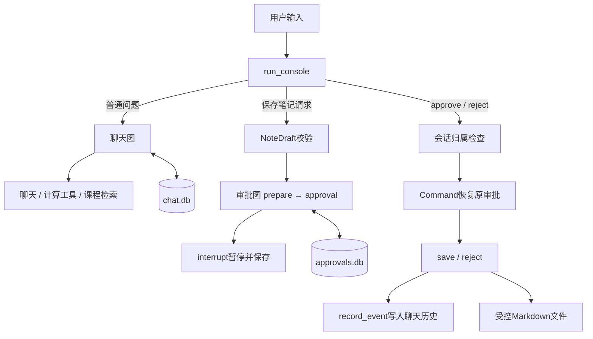

# Day34 最终代码详细解读

入口：day34/python/day34_learning_assistant.py。

审批图：day34_guarded_operations.py，复用note_contract、note_interrupt、note_writer；会话归属检查来自day34_session_checks.py。聊天复用Day33状态、模型与检索模块。

## 一、整体结构



这是CLI协调的两个独立图，不是把审批interrupt塞进聊天图内部。聊天thread_id是session_id；审批thread_id是flow_id。

## 二、main与run_with_databases

main解析会话编号、--demo和--check。后两个参数互斥。

run_with_databases(directory: Path, session_id: str, demo: bool, read=input) -> bool负责创建连接、编译图并运行交互循环。

ExitStack管理两个SqliteSaver上下文，离开时都关闭。聊天图与审批图共用运行目录，但使用不同文件。

demo在文件名和保存目录前加demo_，避免固定Fake回答污染真实模式历史。--check在TemporaryDirectory里做全部操作。

read参数是输入函数。真人使用input，自动检查使用迭代器返回预设文本，因此两种模式执行同一个run_console。

## 三、聊天图的模型与工具

create_models返回绑定旧工具的对象与普通模型；最终入口只使用普通模型重新绑定GUARDED_TOOLS。

正常模式：

- chat_model是普通ChatOpenAI；
- calculator是plain_model.bind_tools(GUARDED_TOOLS)；
- 知识回答也使用plain_model；
- 知识精排由Day22模块执行额外模型调用；
- 路由仍然是关键词规则，不调用模型。

Fake模式使用DemoChatModel、TurnScopedDemoCalculator和DemoAnswerModel。计算样例只支持固定(20+4)*3，不能代表通用Fake数学解析器。

ToolNode绑定的是严格版add/multiply，不再使用Day33宽松工具Schema。

tool_error_message接收异常并返回简短提示，供ToolMessage通知模型修正参数或说明失败；它不把整个原始输入和堆栈追加到模型上下文。

## 四、build_chat_graph中的节点

route把Route枚举转成普通字符串存状态。

chat把临时系统消息和完整messages历史交给模型，回复经response_update写入answer和新AIMessage。

calculate同样接收历史，返回带tool_calls的AIMessage或最终回答。tools_condition控制进入ToolNode或END。

knowledge在一个节点里调用检索、筛选并生成回答。没有证据时立即返回资料不足，证据非空时构建带资料编号的Prompt。

当前知识Prompt只包含本轮问题与证据，没有自动读取整段聊天改写追问。

最终版本允许模型精确回复“当前课程资料不足以回答这个问题。”而不强制带引用；其他回答仍要求合法引用编号。这修正了Day33对诚实拒答也报引用错误的情况。

note_hint只是备用提示。正常CLI会优先拦截/note或含保存笔记意图的输入并启动独立审批图。

## 五、run_console的分发顺序

1. strip输入，空白跳过。
2. exit、EOF或Ctrl+C退出。
3. /help、/session、/history、/status、/flows本地处理。
4. /approve、/reject、/retry进入会话检查和审批图。
5. 其他未知斜杠命令拒绝。
6. 检查聊天图是否存在未完成节点。
7. /note或保存笔记请求创建提案。
8. 普通问题交给UserRequest和run_turn。

ValueError与OSError显示操作失败并继续循环；其他异常显示运行失败并结束。继续循环不意味着自动修复checkpoint，未完成聊天仍被next检查阻断。

## 六、创建提案时的参数传递

```text
输入标题：str
输入正文：str
正文空白 → 从chat状态读取answer
→ NoteDraft(session_id, title, content)
→ 随机flow_id
→ start_flow(approvals, flow_id, draft)
```

正文若采用最近answer，可能是上一条操作提示而非课程正文，因此界面会完整展示快照，用户应核对实际内容。不存在有效正文时模型校验拒绝。

prepare节点生成另一个note_id。flow_id定位审批流程，note_id定位最终笔记文件，两者不能混淆。

start_flow的返回值包含pending_note和interrupt信息。CLI显示标题、正文、快照哈希以及对应批准/拒绝命令。

随后record_event只记录“等待人工审批，尚未保存”，避免模型误读为执行成功。

## 七、NoteDraft、PendingNote与快照绑定

NoteDraft字段是session_id、title、content，采用frozen=True和extra=forbid。

PendingNote字段是note_id、draft、content_sha256、固定pending状态。

snapshot_hash把note_id与草稿内容一起按固定JSON顺序编码后计算SHA-256。不同笔记编号即使正文相同，也对应不同审批快照。

PendingNote的status始终表示提案类型；流程状态由外层state.status表达，所以流程saved后，内部pending_note.status仍可为pending，两者层次不同。

## 八、审批暂停与节点重放

prepare是独立节点，随机编号在这里生成并保存checkpoint。

approval_node先验证快照，再执行interrupt(payload)。第一次运行时返回暂停，后续恢复从节点开头重新执行，interrupt在恢复时返回人工输入。

ApprovalDecision严格要求approved为bool，并携带session_id、note_id、content_sha256。三个标识必须与当前快照一致。

快照绑定防止程序把决定误配到另一笔内容；它不是数字签名，也不代替用户身份认证。

## 九、owned_flows与latest

owned_flows(saver, session_id) -> list[tuple[str, dict]]扫描checkpoint列表，对每个thread_id只保留遇到的最新记录，再检查所属会话。

它不会因为一笔流程有多个checkpoint就列出多条相同流程。

latest使用返回列表首项，表示当前会话最近更新的流程，不保证状态是pending。因此批准已完成的latest会被后续状态检查拒绝。

当前是小规模课程实现，扫描全部checkpoint的成本会随数据增长；生产项目可建立审批业务索引表。

## 十、checked_resume与checked_retry

require_flow_session先读取目标流程，验证pending_note和所属session。它发生在恢复之前，因此跨会话请求被拒绝时不会改变流程状态。

checked_resume再调用resume_flow，确认流程确实有等待人工决定的interrupt，并构造绑定当前快照的ApprovalDecision。

checked_retry调用retry_flow，要求status=failed、approval=True、retryable=True、retry_count小于2，并重新核对草稿。

CLI里当前session由操作者选择，所以归属检查不是防止恶意用户切换编号的认证层。

## 十一、实际文件写入

write_approved_note(state, note_root) -> tuple[Path, bool]返回保存路径及是否复用已有文件。

写入前验证：批准必须严格True；状态符合要求；快照校验有效；原始draft与快照一致；路径位于固定根目录；会话目录不是符号链接。

render_note使用审批快照生成固定Markdown，不添加每次变化的当前时间。这样工作流重试会生成相同字节。

临时文件完整写好后使用os.link发布。目标不存在时首次创建；目标存在时只允许普通文件且字节完全相同，否则拒绝覆盖。

这是针对当前Ubuntu本地文件系统的实现，依赖硬链接支持。目录与文件应由受信任本机程序管理，当前检查不宣称抵御拥有同目录写权限者的所有竞态攻击。

## 十二、写入错误与重试

保存节点捕获ValueError（包含Pydantic ValidationError）并标记不可重试；捕获OSError时只把配置的临时errno标为retryable。

failed结果保存：status、result、saved_file、error_type、retryable。saved_file在未确认成功时为空，即使故障可能发生在文件发布之后，也不会直接报告成功。

重新执行相同写入若发现文件已完整存在，就幂等复用，解决文件系统与checkpoint之间无法一起提交的问题。

retry_flow使用：

```python
graph.update_state(config, update, as_node="approval")
graph.invoke(None, config=config)
```

as_node声明这次更新视作approval节点产出，依据其条件边重新安排save；不是重新从START运行，也不重新生成提案。

## 十三、record_event与消息历史

record_event(chat_graph, session_id, user_text, response)没有调用模型。

它使用update_state(as_node="chat")直接追加一条HumanMessage与一条AIMessage，同时更新answer、route并清空本轮evidence。

记录的response来自审批图实际结果：保存、拒绝或失败，而不是让LLM自行判断操作完成情况。

| 内容 | 是否进入聊天messages |
|---|---|
| 普通用户问题与助手回复 | 是 |
| 计算tool_calls与ToolMessage | 是 |
| /note及等待审批提示 | 是 |
| 成功返回结果的批准、拒绝、重试命令 | 是 |
| /flows、/history、/status、/help | 否 |
| 被归属检查拒绝的命令 | 否 |
| 完整PendingNote对象 | 不作为消息；在审批checkpoint里保存 |

审批图与聊天图没有跨库原子事务。若审批完成后聊天事件记录失败，不能反向推断文件未保存，应使用/flows、审批状态及文件核对。

## 十四、主要数据类型

| 变量 | 类型 | 用途 |
|---|---|---|
| chat / approvals | 编译后的LangGraph | 两套独立工作流 |
| chat_saver / approval_saver | SqliteSaver | 分别保存checkpoint |
| session_id | str | 聊天会话与流程归属 |
| flow_id | str | 审批thread_id |
| note_id | str | 系统笔记文件标识 |
| draft | NoteDraft | 已验证标题正文 |
| pending | PendingNote | 待审批快照 |
| paused / result | dict | 图返回的状态 |
| flows | list[tuple[str, dict]] | 当前会话流程 |
| saved_file | str | 已确认保存的目标路径 |
| read | 输入函数 | 真人交互或脚本化输入 |

## 十五、自动验收做了什么

--check使用临时目录，第一次运行聊天、计算、Fake检索，创建提案后退出。第二次重新打开两份数据库，找到并拒绝旧提案，创建并批准新提案，检查只有一个Markdown且归属于xiaolin，再切换bob验证没有姓名记忆。

它使用真实图、SQLite、ToolNode和文件系统，模型与检索则使用固定Fake。9项独立失败测试补充覆盖错误哈希、权限失败和重试上限等。

本次真实DeepSeek及真实检索尚未运行。明天毕业验收需要分别记录Fake自动测试与真实模型演示结果。

## 十六、Day35接续

保持当前已实现范围，固定验收问题、运行Fake自动测试和真实演示，核查失败与持久化，整理运行说明并完成独立代码讲解。Day34到此7步结束，不再新增日程。
