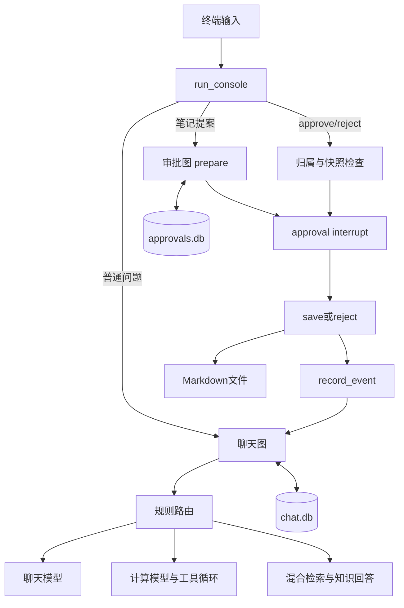
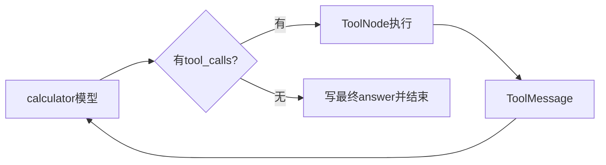

# 毕业项目最终代码详细解读

最终启动命令：

```bash
python day35/python/day35_final_assistant.py xiaolin-capstone-001
```

Day35入口转调已验收的Day34程序，未复制一套新业务逻辑。阅读时要同时看入口、图构建、状态模型、审批和写入模块。

## 一、建议阅读顺序

| 顺序 | 文件 | 重点 |
|---|---|---|
| 1 | day35/python/day35_final_assistant.py | 启动转调 |
| 2 | day34/python/day34_learning_assistant.py | CLI、聊天图、两库协调 |
| 3 | day33/python/day33_persistent_agent.py | PersistentState、run_turn、config_for |
| 4 | day33/python/day33_project_contract.py | UserRequest与Evidence |
| 5 | day34/python/day34_guarded_operations.py | 工具参数、审批图、失败重试 |
| 6 | day34/python/day34_note_interrupt.py | 快照准备、interrupt、resume |
| 7 | day34/python/day34_note_contract.py | 草稿与审批快照 |
| 8 | day34/python/day34_note_writer.py | 确定性文件、原子发布和幂等 |
| 9 | day34/python/day34_session_checks.py | 流程归属检查 |

真实知识检索继续导入Day22混合检索和Day21索引模块。项目当前需要保持这些目录关系。

## 二、从启动开始

day35_final_assistant.py根据__file__找到项目根目录，将day34/python加入sys.path，再导入main。

导入不等于执行交互循环；只有if __name__ == "__main__"下调用main才启动。

Day34.main读取session_id、--demo、--check，校验会话编号，并选定运行目录。

run_with_databases使用ExitStack管理两个SqliteSaver：

```text
chat.db → 聊天图checkpointer
approvals.db → 审批图checkpointer
```

正常模式目录为day34/runtime。demo使用demo_文件名前缀。--check用临时目录。

程序退出时关闭连接，数据库文件继续存在，所以下次可以恢复。

## 三、两张图与CLI的职责



CLI负责用户命令和两图协调。聊天图负责交流、计算和检索。审批图负责高风险写入的暂停、批准与执行。

审批暂停时不占住一个一直运行的Python循环；状态写在数据库，进程可以退出。恢复时重新构建图并读取对应流程。

## 四、共享状态

PersistentState的核心字段：

| 字段 | 类型 | 生命周期 |
|---|---|---|
| session_id | str | 当前会话 |
| question | str | 当前轮覆盖 |
| messages | Annotated[list[BaseMessage], add_messages] | 跨轮合并 |
| route | str或None | 当前轮重置 |
| evidence | list[dict[str,str]] | 当前轮重置 |
| answer | str | 当前轮重置 |
| pending_note / approval | 占位字段 | 真实审批在另一张图 |

TypedDict描述类型，UserRequest做运行时验证。add_messages是消息reducer，通常追加新消息，相同消息ID则更新。

run_turn只传本轮HumanMessage，不把完整历史从CLI重新拼一遍。checkpoint恢复旧状态后，reducer合并新增消息。

## 五、三个编号

session_id用作聊天thread_id，也表达笔记所属会话。

flow_id用作审批thread_id，定位一笔独立审批。

note_id用于笔记文件名和审批快照绑定。

一个session可以有多笔flow，每笔flow创建一个note。会话隔离不等于用户身份认证，当前本机操作者可以切换session编号。

## 六、一轮普通聊天

```text
input → strip → 本地命令判断
→ UserRequest校验
→ run_turn
→ graph.invoke(update, thread_id)
→ router选择chat
→ 临时系统消息 + 历史messages
→ ChatOpenAI.invoke
→ response_update
→ AIMessage合并并checkpoint
→ 最终回答
```

系统消息只存在于该次模型调用参数中，没有作为状态增量返回，因此不进入messages历史。

## 七、计算工具循环

GUARDED_TOOLS包含add和multiply。CalculationArgs采用严格参数Schema：有限数、输入绝对值不超过一万亿、禁止未知字段。

正常模型通过bind_tools得到工具描述，返回AIMessage.tool_calls。本机ToolNode执行函数，并返回ToolMessage。



tools_condition检查最后AI消息是否包含请求，不重新理解用户问题。

工具异常通过tool_error_message变成简短工具错误，模型可以修正参数或说明失败。recursion_limit=20约束图步数，不能保证所有输入都能求解，也不是总时间限制。

实际验收中(20+4)*3产生6条消息：用户1条、两次工具请求2条、两次结果2条、最终回复1条。

## 八、知识检索与回答

retrieve_course_evidence延迟导入Day22模块；模型缓存和索引按已有路径加载。

```text
当前问题
→ 向量检索 + FTS关键词检索
→ RRF融合
→ LLM精排
→ 相关性达到95分的前3条
→ Evidence转dict
```

证据为空直接说明不足。非空时构造编号context，把本轮问题和资料传给普通回答模型。

最终版本识别固定的资料不足回复，其余文本要求存在合法[资料N]。引用编号检查不等于语义支持度或完整事实审计。

模型Prompt没有自动拼入整段历史改写检索问题，因此指代不清的追问仍是能力边界。

## 九、模型到底有几个

普通聊天与知识回答复用plain_model；计算使用它绑定工具后的Runnable。它们对应同一份DeepSeek配置，但每次invoke都是独立请求。

精排由Day22创建结构化模型调用。Embedding是本地文本向量模型，不是聊天模型。路由、条件边、参数校验、审批和文件写入都由本机代码完成。

模型对象角色、请求次数和供应商模型名称是三个不同概念。

## 十、创建待审批笔记

CLI先识别/note或明确保存笔记请求，读取标题正文。正文留空时采用最近answer，所以用户必须核对实际预览。

NoteDraft校验通过后生成flow_id，start_flow进入prepare节点。prepare_note生成note_id和content_sha256。

哈希覆盖note_id、session_id、title、content。哈希不是签名或认证，只用于检查审批对象是否一致。

approval_node执行interrupt展示快照并暂停。pending_note作为普通dict进入审批checkpoint。

## 十一、批准恢复

```text
/approve flow_id
→ require_flow_session核对归属
→ resume_flow核对实际interrupt
→ 读取待审批快照
→ ApprovalDecision(会话、笔记编号、哈希、True)
→ Command(resume=...)
→ approval节点从开头重新执行
→ interrupt返回恢复值
→ 严格校验决定
→ save
```

随机准备在前置节点，副作用在后置节点，是为了避免approval重放时生成新编号或提前写文件。

拒绝时走reject，不调用保存函数。已完成流程不能重复审批。

## 十二、保存与幂等

write_approved_note先验证批准状态、原草稿与快照一致、哈希有效和路径边界。

render_note生成确定性Markdown。临时文件完整写好并fsync，再用os.link以不覆盖方式发布。

目标存在：普通文件且字节相同则复用，不同则拒绝。这样同一写入重试不会产生第二份文件。

这解决单机文件写入与checkpoint确认之间的常见重试窗口，但不提供跨数据库和文件系统的统一事务。

## 十三、错误与重试

save节点捕获参数、快照、冲突错误以及OS写入错误，记录failed、error_type、retryable。

EBUSY等临时errno允许人工重试，最多2次；权限不足、磁盘满等不直接标记为可重试。

retry_flow重新核对原批准与快照，通过update_state(as_node="approval")调度save，然后invoke(None)。它不重新生成提案，也不重新请求人工决定。

## 十四、聊天历史如何反映审批结果

record_event不调用LLM，直接把CLI行为与审批图真实结果写成HumanMessage和AIMessage。

待审批时只说等待；批准成功才说已保存；拒绝或失败如实记录。

如果审批已经保存但聊天事件写入失败，保存事实仍应依据审批checkpoint和文件核对。两张图没有跨库事务。

| 数据 | 聊天messages | 其他保存位置 |
|---|---|---|
| 用户问答 | 是 | 聊天checkpoint |
| 工具请求与结果 | 是 | 聊天checkpoint |
| RAG evidence | 否 | 聊天状态字段 |
| 临时系统Prompt | 否 | 本次调用参数 |
| 精排评分 | 否 | 用于筛选；非完整历史审计 |
| 笔记快照 | 不直接追加 | 审批checkpoint |
| /note与实际审批结果 | 是 | 同时有审批状态 |
| 帮助、列表、状态查询 | 否 | 终端显示 |

## 十五、Day35验收代码

acceptance_plan固定G01—G12，定义步骤、判据、证据和模式，计划不等于结果。

fake_acceptance使用unittest逐项执行，真实图、工具、SQLite与文件，Fake模型与检索。EvidenceResult记录状态、耗时、证据和节点日志。

live_acceptance执行约定的5项真实模型场景，使用独立运行目录；API/网络/环境故障记blocked，断言不满足记failed，不用Fake补成功。

reliability_audit核对报告覆盖和关键证据，用两个独立Python子进程补充G08恢复。第一个进程退出后，第二个只凭磁盘恢复姓名和原提案，批准后核对文件内容与数量。

## 十六、已记录结果

- Fake：G01—G12全部通过。
- Live：G01、G02、G03、G04、G08全部通过。
- 可靠性核查：报告覆盖和独立进程恢复均通过。
- 真人独立讲解：练习已提供，尚未由自动化测试证明。

报告位于day35/reports。每份结果有自己的验证范围，不能把固定问题通过外推为所有输入都正确。

## 十七、后续修改入口

调整计算能力：严格工具Schema和GUARDED_TOOLS，同时更新模型工具绑定与验收。

调整检索：Day21/22索引和检索模块，重新验证阈值与知识场景。

调整审批：快照模型、审批图、归属检查和写入函数一起考虑，避免只改界面提示。

调整交互：run_console及其脚本化验收，不应把普通聊天yes误当成批准。

后续按真实项目需求修改，并以固定验收集做回归；本轮35天课程在此结束。
