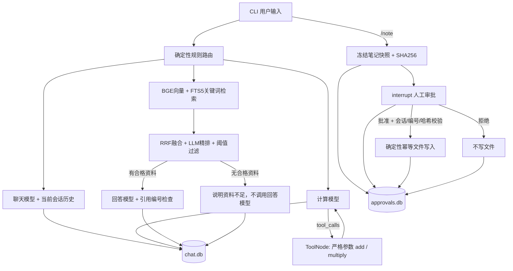

# Learning Agent · 编程学习助手

[](https://github.com/as2132r2/learning-agent/actions/workflows/ci.yml)

一个可以在本地运行、暂停审批并在重启后恢复的 **LangGraph CLI Agent**。把聊天、计算工具、带来源的知识检索与笔记写入串成可观察的工作流，而不是让模型直接操作文件。

本项目由我的 LangChain / LangGraph 学习毕业项目整理而来。开源版仅包含独立业务代码、原创示例资料与自动化测试，不包含课程聊天数据库、真实密钥或私人上传文档。

## 先运行，不需要 API Key

Python 3.11+：

```bash
git clone https://github.com/as2132r2/learning-agent.git
cd learning-agent
python -m venv .venv
source .venv/bin/activate
pip install -e .
python -m learning_agent --check
python -m learning_agent xiaolin --demo
```

`--demo` 使用确定性 Fake 模型和固定 RAG 证据，不发起模型请求，但 **图、计算工具、SQLite 检查点和文件写入是真实执行的**。计算只演示 `(20+4)*3`，不应把演示结果当作通用模型能力。

在交互界面依次输入：

```text
我叫小林。
请计算(20+4)*3。
刚才的结果是多少？
根据资料解释RAG。
/note
RAG复习
先检索，再根据资料回答。
/flows
/approve latest
/history
exit
```

`/note` 后两行分别是标题和正文；批准前不会保存笔记。再次以同一会话启动可恢复聊天和未完成审批。`latest` 指当前会话最近更新的流程，不一定是待审批流程；有多笔审批时建议使用 `/flows` 展示的明确编号。

## 使用真实模型与检索

```bash
pip install -e ".[rag]"
cp .env.example .env
# 在编辑器里填写自己的 DEEPSEEK_API_KEY；不要提交 .env
python -m learning_agent xiaolin --data-dir runtime
```

普通聊天和计算需要模型 API；首次进入知识路线还会下载 `BAAI/bge-small-zh-v1.5`，需要联网。模型服务可能收费。API Key 只从当前工作目录 `.env` 或进程环境读取，环境变量优先。

真实知识路线：示例文件 → 本地 BGE 向量 + SQLite FTS5 → RRF → LLM 精排 → 阈值过滤 → 引用回答。正文和向量缓存在运行目录，文件内容或 Embedding 模型变化会重建索引。仅支持包内短 TXT/Markdown 文档，每份最多 8000 字符；并非通用文档管理平台。SQLite 需要支持 FTS5 trigram（SQLite 3.34+）。

`RERANK_THRESHOLD=95` 是保守起点，**并非针对开源版资料重新标定后的质量保证**。实际使用应增加带标注问题集后评测阈值。

## 架构



CLI 将审批的实际结果写回聊天历史，让模型读到的是“等待审批 / 已保存 / 被拒绝”等事实，不是猜测。聊天和审批使用独立 SQLite 检查点。

## 工程边界与设计

- **工具参数**：Pydantic 严格类型、有限数值、范围和额外字段检查；工具错误返回模型，不伪装成成功。
- **审批快照**：绑定会话、笔记编号、标题和正文；恢复必须匹配同一份 SHA256 快照。
- **写入幂等**：临时文件 + `fsync` + 同目录硬链接发布；同编号同内容复用，不同内容拒绝覆盖。
- **失败恢复**：仅对白名单临时存储错误开放最多两次手动重试；权限错误、拒绝和重复审批不会自动重试。
- **会话隔离**：历史与审批都检查 session_id，但这是本地调用约束，**不是用户登录认证**。
- **证据边界**：引用检查只验证编号存在，不等于语义支持度验证；资料中的指令不应执行，但提示词本身不构成完整防注入保障。

## 测试

```bash
python -m unittest discover -s tests -v
python -m learning_agent --check
```

测试不需要密钥。覆盖记忆隔离、真实工具调用与 ID 对应、无证据跳过回答、审批后写入、拒绝不写、重连恢复、非法参数、临时失败、写入冲突、跨会话访问、快照篡改、重复审批与重试上限。另有独立进程恢复与混合检索基础测试。

详细范围见 [测试与验证说明](testing.md)，贡献方式见 [CONTRIBUTING.md](../CONTRIBUTING.md)。GitHub Actions 在 Python 3.11 / 3.12 下运行离线测试；不在 CI 中调用付费模型。

## 源码导航

| 模块 | 作用 |
| --- | --- |
| `app.py` / `routing.py` | CLI、图编排、规则路由 |
| `memory.py` | 消息合并、会话检查点、离线模型 |
| `knowledge.py` | 本地索引、RRF、精排与证据过滤 |
| `contracts.py` / `notes.py` | 输入与不可变笔记快照 |
| `approval.py` / `session_checks.py` | interrupt 恢复与归属检查 |
| `operations.py` / `writer.py` | 严格工具、受控重试、幂等文件发布 |

## 当前限制

这是单机学习/作品展示项目，不是生产级多租户服务。没有 Web UI、用户认证、分布式队列、历史压缩或自动恢复中断的聊天请求；完整历史会随会话增长。RAG 仅使用当前问题检索，尚未做多轮问题改写。SQLite 与文件系统不是同一事务；幂等写入降低重复副作用，但不提供跨存储的 exactly-once 保证。文件安全假设本机和运行目录可信，不防御恶意本地用户的所有竞态。

未接入项目之外的 MCP 服务、转账或任意系统命令。更完整的学习过程留在本地课程目录，避免把大量教学脚本包装成已集成的线上能力。

## License

[MIT](../LICENSE)。内置示例资料为本项目原创学习说明；使用第三方模型与服务时还需遵守其各自许可和条款。
